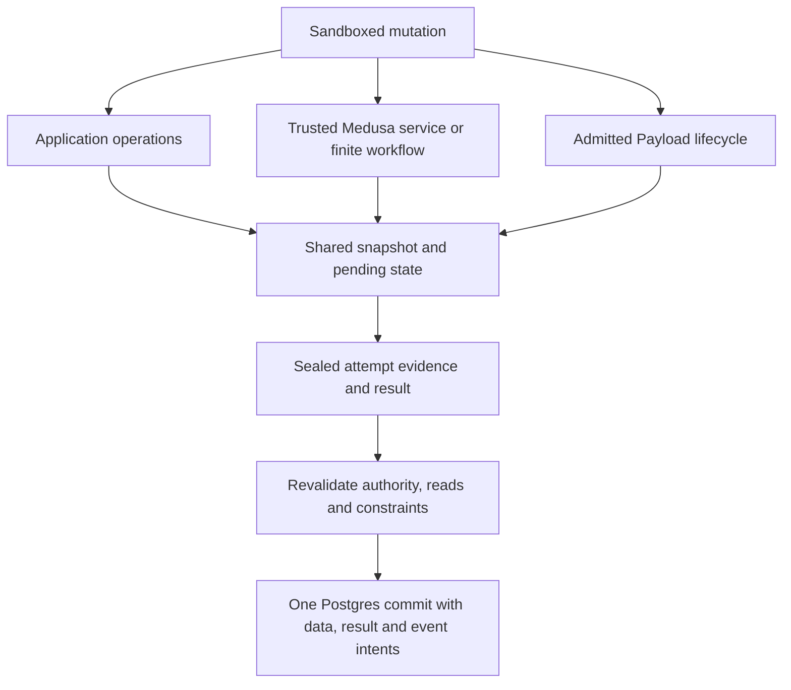

# Mixed Application, Payload And Medusa Mutations

Status: accepted and implemented for the private Application/Product, selected
Payload Local API and finite Medusa workflow slices in isolated scopes. The
[workflow preflight](../roadmaps/mixed-mutation-core/03-finite-medusa-workflow-preflight.md)
owns its bounded native graph; its public API and hosted activation remain deferred. The other shared-storage
session has completed its active [exact-scope retained-history slice](../roadmaps/shared-logical-storage/56-same-deployment-scope-authority.md)
and paused at a clean committed handoff; the shared-storage domain still has
remaining work. The [first focused preflight](../roadmaps/mixed-mutation-core/01-application-product-attempt-preflight.md)
owns the approved private Product operation, attempt defaults and validation
gate. The [Payload preflight](../roadmaps/mixed-mutation-core/02-payload-local-api-attempt-preflight.md)
owns its implemented private lifecycle. Developer APIs remain deferred. These
approvals do not authorize public
exposure, named-environment journal migration or changes to locking. The [mixed core roadmap](../roadmaps/mixed-mutation-core/README.md)
owns current status and connected delivery gates.

## Outcome And Authority

Let an application author compose Application data operations, admitted Medusa
services and Payload operations inside one native mutation. The entire mutation
has one atomic database outcome, including any admitted nested workflow work.
The author can use earlier results, branch and perform further operations without
registering a separate trusted business command for each combination.

This selects the product requirement described by the existing
[optional general mixed OCC branch](./flarexdb-commerce-occ-migration-preflight.md#optional-general-mixed-occ).
The [accepted database design](./flarex-db-accepted-design.md),
[shared logical storage decision](./flarexdb-shared-logical-storage.md) and
[execution-profile contract](../roadmaps/flarexdb-framework-integration/preflight/14-transaction-execution-profiles.md)
remain authoritative until an approved design explicitly revises them. Existing
framework command and native mutation profiles retain their current contracts.

Illustrative future syntax, not an existing API, a final naming decision or a
deliverable of the proposed core phase:

```ts
export const publishProduct = mutation(async (ctx, args) => {
  const launch = await ctx.db.launches.create({ title: args.title });

  const product = await ctx.commerce.product.update(args.productId, {
    title: args.title,
    status: "published",
  });

  await ctx.db.launches.patch(launch.id, { productId: product.id });
  return { launchId: launch.id, product };
});
```

The same execution contract should admit selected `ctx.cms` operations and
finite Medusa workflows once their full behavior passes the relevant gates.
The guarantee covers one authorized scope and physical database placement.
Cross-placement work requires committed steps and a durable coordination contract.

## Sequencing And Core Scope

The other shared-storage session has finished, reviewed, validated and committed
its active exact-scope retained-history slice, then confirmed a clean pause and
handoff. Its [completion plan](../roadmaps/shared-logical-storage/03-completion-plan.md)
still owns the uncompleted storage backlog. The mixed core need not wait for
that entire goal, but must not silently absorb its remaining consumer migrations.
The first [focused preflight](../roadmaps/mixed-mutation-core/01-application-product-attempt-preflight.md)
approves the Application and Product private attempt after its baseline audit;
the [second](../roadmaps/mixed-mutation-core/02-payload-local-api-attempt-preflight.md)
owns the implemented Payload lifecycle under the same root. Each owns its exact
authority, cutover and validation scope. The [workflow preflight](../roadmaps/mixed-mutation-core/03-finite-medusa-workflow-preflight.md)
owns the implemented finite private runtime package. The [mixed core roadmap](../roadmaps/mixed-mutation-core/README.md)
tracks remaining gates and work.

The approved private core phase covers attempt participation, snapshot and pending reads,
journal evidence, OCC validation, settlement, recovery, framework lifecycle
integration and connected private proofs. It may change necessary internal
contracts and migrate their consumers. Use existing private host/sandbox test
entry points or narrowly scoped internal test bindings to exercise the real
execution path without exposing a new application authoring surface. Tests must
preserve the production trust boundary and reuse the real owners.

Public `ctx.commerce`/`ctx.cms` surfaces, SDK methods and generated types,
developer-facing registration/configuration APIs, API naming and hosted
activation are deferred to separately scoped work. The examples in this note
express the eventual behavior that core must support; implementing those example
APIs is not a completion gate for the core phase.

## Why The Earlier Design Kept Separate Profiles

The earlier decision preserved framework behavior while sharing persistence,
settlement, publication and recovery. Native OCC can rerun application code;
arbitrary framework operations are not automatically safe to rerun.

- Payload performs access checks, validation, hooks and nested Local API work.
  Its `afterChange` hooks execute before commit. Upload and verification-email
  paths can also run before commit. Neither SQL rollback nor OCC undoes an
  external effect, and moving every hook after commit changes framework behavior.
- Medusa services propagate a borrowed transaction manager, while workflows can
  have steps, effects, waits, independent retries and compensation. Reusing a
  service transaction does not make a whole durable workflow atomic.
- A framework query needs complete snapshot and dependency semantics, including
  missing rows, predicates, ranges, ordering, aggregates and pending changes.
  Returned row IDs or final write facts alone are insufficient for OCC.
- Database transactions must not remain open across sandbox execution, remote
  effects, workflow suspension or arbitrary user callbacks.

The [original source audit](../roadmaps/flarexdb-framework-integration/preflight/14-transaction-execution-profiles.md#source-evidence)
records the pinned framework evidence. Separate execution was a compatibility
and sequencing choice. It does not establish that mixed mutations are impossible
or that separate profiles have universally better performance.

## Baseline Foundations And Later Contracts

The table records the baseline gaps that motivated the first slice and the
contracts still needed for broader admission. Before the finite workflow package,
the implemented Product and selected Payload paths used a one-source journal
operation and one pending point overlay,
borrowed logical working sets and authenticated source effects under the root.
Those contracts are proved for their pinned operations, not for an arbitrary
framework operation or historical text search.

| Owner | Reusable foundation | Baseline or later-admission gap |
| --- | --- | --- |
| [Native session journal](../packages/persistence-postgres/src/sessionJournalStore.ts) and [commit owner](../packages/persistence-postgres/src/pointCommitTransaction.ts) | Attempt identity, snapshot reads, pending point/index state, authenticated sealing, OCC and recovery | Authenticate framework operations and their complete dependencies without granting ordinary Application writes to framework-owned tables |
| [Logical working set](../packages/persistence-postgres/src/logicalDocuments/workingSet.ts) | Pending documents, indexed queries, unique observations, relational checks and resource accounting; selected Product/Payload and finite multi-source workflow borrowed historical reads are implemented in isolated scopes | Broader query forms need their own exact pending and dependency proofs |
| [Shared index/search definitions and entries](../packages/persistence-postgres/src/logicalDocuments/searchEntries.ts) | Ordered and unique access, current text/JSON search, atomic maintenance and scoped readiness | Establish snapshot candidate selection and complete conflict evidence for each admitted access path; current-search entries alone do not provide historical search |
| [Shared materialization](../packages/persistence-postgres/src/logicalDocuments/materialization.ts) | Generic row/index/constraint preparation and lowering | Validate one combined mutation contribution across authenticated semantic owners |
| [Medusa repository context](../packages/medusa-adapter/src/commerce-repository-context.ts) and [Payload adapter](../packages/payload-adapter/src/adapter.ts) | Opaque manager/request propagation and framework translation | Borrow mutation-attempt capabilities instead of independently executing a root command |
| [Workflow runner](../packages/medusa-workflows-sdk/src/runtime.ts) and [adapter runtime](../packages/medusa-adapter/src/workflow-runtime.ts) | Finite ordered steps, child frames, captured results and caller-owned execution | Participate in a native attempt and its whole-mutation retry contract |
| [Committed event store](../packages/persistence-postgres/src/commitEvents/store.ts) | Durable event intent and delivery evidence | Bind selected framework events to the mixed attempt and its one final outcome |

The private [Currency/CMS/Application command](../roadmaps/shared-transaction-core/05-named-command-preflight.md)
proves explicit trusted composition under one SQL transaction. Its Application
participant supports one insert. It does not provide arbitrary sandbox interleaving
or allow ordinary mutations to call independently committing framework hosts.

The first slice refactors the working-set construction for a disposable borrowed
operation while retaining its shared query, constraint and relation mechanics.
Later framework methods still need their own complete historical candidates,
dependency evidence and admission proof.

### Redesign Depth

This is a substantial execution redesign across connected owners. A small
Application/Product example is the first behavioral proof, not an estimate of
the underlying change size. The first slice selected and implemented the
contracts needed for that Product path; later admissions must reassess the
remaining breadth against their selected call graphs:

| Area | Required change and reusable foundation |
| --- | --- |
| Working set | Major refactor of its physical-transaction-bound construction and pending evaluation into the admitted snapshot/attempt contract. Reuse query, index, constraint and resource mechanics where they preserve that contract. |
| Logical journal | Significant extension for authenticated framework participation, operation/result evidence, dependencies and pending effects. Reuse attempt identity, sequencing, sealing and recovery. This is the logical attempt journal, not PostgreSQL WAL. |
| OCC | Extend evidence collection and validation for every admitted framework decision, including absence, ranges, query membership, relations and constraints. Preserve the principle of validating the observations that informed the mutation. |
| Transaction orchestration | Refactor framework calls and child workflows to borrow one logical attempt. The root owns budgets, cancellation, whole-attempt conflict retry and settlement. |
| Physical commit/publication | Reuse the existing authoritative settlement, materialization, event and retained-outcome owners; extend combined validation and contributions where required. One logical transaction does not mean one SQL transaction held throughout user execution. |
| Framework integration | Adapt manager/request propagation and finite workflow execution while preserving native validation, hooks, events and failure behavior. |

The two largest design questions are coherent snapshot-plus-pending evaluation
and complete dependency evidence for framework queries. Existing row history
does not alone prove historical index or relational-query behavior. An indexed
query can become stale when a concurrent insert changes its membership even if
none of its previously returned rows changed. Existing framework writes must
also preserve the evidence needed by mixed attempts.

Logical tables, indexes, constraints, native services and the shared settlement
foundation remain useful. The shared-storage baseline does not itself establish
one snapshot, pending view or retry contract across the three execution profiles.
Exact journal/protocol changes and data obligations require an inventory; this
note does not prescribe new tables, a universal interpreter or a second ledger.

## Execution Model And Proposed Extensions

One logical mutation attempt owns the snapshot, pending state, dependency set,
event intents, result and final settlement. Physical Postgres transactions remain
short-lived for admitted reads, attempt evidence and final publication.



### Attempt And Domain Authority

The native coordinator owns one attempt and its existing lifecycle. Framework
calls receive opaque borrowed capabilities bound to that attempt, scope,
placement, selected schema/bindings, principal and admitted methods. Revalidate
the required authority at entry and settlement. A stale binding cannot silently
select a different framework contract during execution or recovery.

`ctx.db` retains Application write ownership. `ctx.commerce` runs actual Medusa
services and their validators; `ctx.cms` runs the supported Payload Local API
lifecycle. Shared storage grants no direct cross-owner mutation rights. Raw SQL,
transaction handles, finalizers and host resource locators remain private.

Trusted framework code and sandboxed user hooks keep their existing trust
boundaries. A reviewed wrapper, timeout or method declaration alone does not
prove an arbitrary callback is free of external effects. Admission must cover
the complete call graph and the capabilities available to every callback.

### Snapshot, Pending State And Journal

Every admitted read uses the same logical snapshot plus earlier pending changes,
including changes issued through another admitted domain capability. Relevant
cross-domain reads still require explicit authorization and query support.

The first private slice used one source per admitted operation in the durable journal
and its point rows as the single pending view. A borrowed logical operation
hydrates its disposable working set from the authenticated snapshot and pending
points, then returns checked effects for atomic journal acceptance. No SQL
transaction spans sandbox execution or the Product service callback. Later
admissions must preserve this ownership; an evaluation cache cannot become
another commit or recovery authority.

Framework calls execute when invoked so their results can guide later code.
Record the required operation/result evidence and resulting data dependencies.
Commit applies validated data changes; it does not rerun services or hooks.
Repeated transport calls within an attempt must not execute a service twice.

Queries must correctly track point absence, range membership, predicates,
ordered pages, aggregates and constraint decisions. They must include local
inserts, edits and deletions. Historical row support alone does not establish
historical index, unique-key or relational-query behavior. Unsupported query or
lock semantics fail admission rather than reading current state outside the
mutation's snapshot. All writers to participating data must preserve the required
history and conflict evidence or be excluded from that admitted profile.

### Nested Calls, Failures And Resources

Nested framework transactions and workflows borrow the attempt. Child completion
neither commits nor creates an independently replayable successful outcome.
The root owns aggregate call, byte, query, event, execution and retry budgets;
nested entry does not reset them. Cancellation drains and revokes active work.

Preserve existing catchable native validation behavior. For the initial mixed
profile, a framework failure after it may have staged work makes the attempt
rollback-only; catching the boundary exception cannot commit a partial service
operation. Define which pre-effect input/domain failures remain catchable.
Savepoint recovery is not implied by this proposal.

Begin with the current ordered workflow profile. Unsupported parallel workflow
constructs remain explicit refusals; do not silently serialize upstream parallel
semantics. Concurrent calls against one mutable attempt require their own
sequencing and visibility proof before admission.

## Shared Index And Search Participation

Index and search correctness belong in the core execution design for Application,
Payload and Medusa. Reassess and reuse the migration's final shared owners before
changing their contracts. Framework adapters translate their native declarations,
operators and results; core owns logical identity, scope confinement, build and
readiness, atomic maintenance, bounded execution, pending visibility, snapshot
selection and conflict evidence. Keep domain-specific matching and lifecycle
semantics explicit. Shared storage does not automatically admit every query in
every execution profile or expose a developer search API.

### Existing Access Paths And Semantic Boundaries

| Requirement | Existing foundation and boundary |
| --- | --- |
| Equality, ranges and ordered pages | Shared ordered logical indexes, typed bounds and membership evidence. [Payload scalar and compound declarations](../roadmaps/shared-logical-storage/05-indexed-payload-queries.md) already reuse Application index machinery. |
| Conditional uniqueness | Scoped unique claims with predicate and null semantics; observation is not a substitute for atomic enforcement. |
| Medusa Product `q` | [Shared text search](../roadmaps/shared-logical-storage/45-core-indexed-text-search.md) over current declared fields using trigram GIN and exact native matching. |
| JSON containment | [Shared JSON access](../roadmaps/shared-logical-storage/46-core-json-containment-index.md) over explicitly declared current fields using GIN with `jsonb_path_ops` and exact containment checks. |

The [physical schemas](../packages/persistence-postgres/src/schema.ts) use generic
families shared across scopes and logical definitions. Product `q` uses
`gin_trgm_ops`; `btree_gin` supplies scalar operator classes for scope and index
identifiers inside the composite GIN path. It is not ordinary B-tree substring
search. Different physical access paths are justified by different query
operators; their lifecycle and transaction authority remain shared.

The current Product contract is ASCII-folded SQL `LIKE` matching over declared
fields, including its wildcard behavior. It does not establish ranked full-text
search, typo tolerance, language analysis or arbitrary Payload operator parity.
Text equality, substring matching, JSON containment and ranked search must not be
treated as interchangeable capabilities. Reuse the mechanics where semantics
agree and admit each consumer's query contract explicitly.

### Snapshot Search Is A Required Design Decision

The current text and JSON families retain current entries tied to row revisions.
The working set merges pending rows and [revalidates captured search membership](../packages/persistence-postgres/src/logicalDocuments/contribution.ts)
at settlement. Those mechanics do not alone implement an older native attempt
snapshot across separate physical transactions.

For example, Product A is named `red shirt` when a mutation starts at snapshot
100. Another writer commits `blue shirt` at 101 before the mutation first
searches for `red`. A current-only search index can omit A even though it belongs
in the snapshot result. Loading historical bodies for returned candidates cannot
recover an omitted candidate. Repeating the same current search at settlement
does not repair that initial snapshot mismatch.

For each admitted access path, select and prove historical candidate selection,
or a conservative change-detection protocol that retries/refuses when the current
path cannot safely serve the attempt snapshot. The latter must cover relevant
changes since the snapshot and races between its protection/check and candidate
read; it cannot return an inconsistent result and rely only on a later recheck.
Keep unsupported paths unavailable until their contract is proved. Do not move
the attempt snapshot forward mid-execution or hold a database transaction across
untrusted work to bypass this requirement. Indexing every historical document
into GIN is not a default decision; compare its retention and write costs with
the alternatives before selecting a representation.

### Required Per-Path Contract And Proofs

| Concern | Required contract |
| --- | --- |
| Snapshot and authority | Pin the admitted source/index identity and establish complete authorized candidates at the attempt snapshot. |
| Pending visibility | Merge local inserts, edits, deletes, soft-delete/restore and predicate transitions; remove old matches and add new ones within the same attempt. |
| OCC evidence | Protect empty results, new/disappearing matches and changes to returned values; preserve the relevant order, page, count and constraint decisions. Row IDs alone are insufficient. |
| Build and lifecycle | Define concurrent build/activation behavior, stale-definition refusal, coverage, retention expiry and retirement while attempts or recovery still reference an index. |
| Semantics and bounds | Preserve admitted matching, ordering, null, projection, count and pagination meaning. Overflow refuses rather than returning a partial result as complete. |
| Maintenance and cost | Maintain entries atomically with rows and publication under the shared writer protocol; account for reads, writes, bytes, history and coverage contention. |

Add connected witnesses for a pending text/JSON match appearing and disappearing,
concurrent insert/update/delete/restore changing membership, and a change between
attempt creation and its first search. Include conditional-index membership,
empty-result conflicts, scoped isolation, activation changes, rollback, replay
and retention expiry for the selected contract. Exercise standalone framework
writers against mixed attempts; separate source families do not remove that
interoperability obligation. Use private bindings and existing framework calls.

Short/common patterns, large matching sets and planner selectivity retain their
explicit limits. GIN availability and a returned-row limit do not prove bounded
database work. Current search maintenance rewrites affected entries and advances
coverage; measure its amplification and revision ties before deciding whether
unchanged searchable values can avoid index rewrites. Physical layout, caching,
batching and selectivity tuning follow the performance sequence below. Snapshot
and conflict correctness cannot be deferred as performance work. Developer search
APIs and additional search semantics remain separately scoped.

## Payload Hooks, Events And External Effects

Preserve admitted access/validation reads, hook arguments, ordering and nested
request reuse. Database-only hooks can participate if they use the same attempt
and satisfy its retry and trust contract. Unknown hooks cannot acquire framework
write or external-effect authority through configuration alone.

Capture supported module and workflow events as separate checked event families.
Commit their intents with the data and root result; dispatch only after confirmed
settlement. Preserve framework event identity, grouping and cardinality instead
of suppressing apparent duplicates. Subscriber failure affects delivery state,
not the successful database outcome. External delivery may require idempotent
consumers; this proposal does not promise exactly-once remote effects.

Email, uploads, payments and arbitrary network calls require an explicit durable
effect contract or execution outside the mutation. Converting a pre-commit effect
into a deferred intent is an observable compatibility change that must be
documented and tested. A feature that requires the external result before its
next database decision generally belongs in a durable workflow.

## Medusa Workflow Participation

The selected private catalogue-launch parent pins a 30-second borrowed command deadline within the existing trusted logical atomic 10–30-second range and a 256-call budget for its two children within the existing 4,096-call shared ceiling. Both selections enter the profile revision. Other framework profiles retain their default 10-second deadline, and the standalone pricing child retains its 128-call selection. The root attempt lease and shared ceilings do not change. Product, Pricing and Link heads are checked on each short historical read; common activation/readiness projection may be reused only inside that transaction.

The [current native workflow profile](../roadmaps/workflow-foundations/10-medusa-workflow-integration.md)
and [child composition](../roadmaps/workflow-foundations/15-native-workflow-composition.md)
already reuse selected Medusa business definitions through one Flarex-owned
runner. They do not execute the original WorkflowManager/LocalWorkflow scheduler
as a second owner. The proposal changes the borrowed persistence context, not
the ownership of Medusa's business sequence.

| Workflow behavior | Proposed contract |
| --- | --- |
| Steps, transformations, conditions and admitted hooks | Execute against the root attempt; outputs are provisional until it commits |
| Child workflow | Borrow root capabilities, pending state and budgets; retain local evaluation frames |
| OCC restart | Rerun the whole mixed mutation with fresh workflow state; do not resume only the failed step using outputs from the abandoned snapshot |
| Transaction-covered compensation | Discard uncommitted changes on failure; do not run compensating deletes against rows that never committed |
| Durable compensation | Retain for previously committed work or external effects under the durable execution contract |
| Independent step retry, suspension, signal or remote effect | Outside the initial atomic profile; requires durable execution or an explicitly proved narrower contract |

Admit workflow/hook code revisions and full transitive service, graph and event
capabilities. A workflow name or a finite graph does not prove replay safety.
Time, generated IDs and randomness must obey an explicit attempt/replay contract;
no callback may publish provisional identities externally before settlement.

A durable workflow can contain multiple mixed atomic mutations. A mutation may
also record a durable workflow-start intent atomically if the existing Task and
publication owners prove that handoff. Neither case makes a workflow containing
waits or external effects one database transaction. That integration remains a
separate gate, not a second scheduler or a volatile after-commit callback.

## Concurrency, Locking And Deadlocks

### Protect Decisions, Not Only Final Writes

Two attempts may read stock equal to one and each stage a reservation. The first
may commit; the other must detect its stale dependency and rerun the whole
decision against a fresh snapshot. Do not silently overwrite the first result.
Also protect invariants spanning different rows, such as total reservations
below capacity or the absence of another active record. Row write conflicts
alone do not prevent write skew or phantoms.

Retain the existing shared [scope-clock lock contract](../roadmaps/shared-transaction-core/36-ce3-scope-clock-lock-contract.md)
for publication initially. Its same-scope serialization is a performance cost,
not evidence that every dependency is correct. Shortening or partitioning that
critical section requires a coordinated writer/activation/migration proof.

### Database Lock Order

Do not hold business-row locks across sandbox execution or workflow callbacks.
Use short physical transactions and acquire final write/constraint protection
under the established publication protocol. Audit request exclusion, lifecycle,
scope-clock, schema/build, session/journal, unique, relation and business-row
locks across all participating writers before fixing the complete order.

Use a consistent order within each required resource class and retain existing
clock-before-business-write obligations. Sorting document IDs alone does not
cover implicit unique/FK locks or inversions with another writer. Bound lock
waits, preserve cancellation cleanup and handle confirmed database deadlocks.
Do not claim the design is deadlock-free because application execution uses OCC.

PostgreSQL recommends consistent acquisition order and aborts a participant when
it detects a database deadlock. Its [locking documentation](https://www.postgresql.org/docs/18/explicit-locking.html#LOCKING-DEADLOCKS)
and [retry guidance](https://www.postgresql.org/docs/18/mvcc-serialization-failure-handling.html)
are supporting evidence; Flarex's actual lock interactions need ordinary-role
PostgreSQL tests on distinct connections.

### Medusa Resource Locks

The pinned [acquire-lock step](../third_party/medusa/upstream/packages/core/core-flows/src/locking/steps/acquire-lock.ts)
has owner, expiry, waiting and release semantics. A resource lock cannot become
a no-op or an OCC dependency without proving that the protected behavior agrees.

For each admitted lock, determine whether it protects a database invariant or
exclusive execution across effects/commits. A database invariant may permit an
explicit adaptation to dependencies and constraints. Execution exclusion needs
resource ownership, bounded acquisition, renewal/release and fencing: an expired
owner must not continue protected work after a successor takes over.

Prevent waits that form cycles across resource and database lock systems. A
database deadlock detector cannot be relied on to detect an application-level
cycle involving an external lease. Multiple-resource ordering, partial acquisition
cleanup and dynamically discovered resources need an explicit protocol. No SQL
transaction may remain open while waiting on a workflow resource lease.

The [resource coordination preflight](../roadmaps/workflow-foundations/08-resource-coordination.md)
is still pending. Workflows requiring unsupported lock semantics remain outside
the first mixed profile. Task attempt leases are not automatically business
resource locks.

## Retry, Recovery And Settlement

| Outcome | Required action |
| --- | --- |
| Logical read/write dependency conflict | Discard pending work and retry the whole admitted mixed mutation with a fresh snapshot and framework state, within the root retry budget |
| Permanent input, authority or business failure | Return the typed failure; do not blindly retry it |
| Confirmed pre-decision database abort | Use the existing settlement owner's bounded retry policy and revalidation; do not infer safety from an arbitrary error string |
| Unknown COMMIT outcome | Resolve exact retained evidence before any re-execution; a missing response or inconclusive lookup is not proof of rollback |
| Confirmed committed result | Return the retained result without rerunning services, hooks, workflow steps or event capture |
| Cancellation racing with commit | Preserve the actual durable outcome, revoke further calls and finish owned cleanup; do not report rollback solely because the caller stopped waiting |

Keep request identity, attempt identity and operation sequencing distinct. Pin
framework bindings, workflow/hook revisions and event contracts as required for
admission and recovery. Define whether a conflict retry retains those pins or
refuses after activation changes; never silently swap behavior. Existing native
sealing, fencing, retained outcomes and uncertainty recovery remain the starting
owners. Neither the adapters nor workflow runner introduce another recovery ledger.

## Refactor, Compatibility And Cleanup

The owner explicitly extends the [repository breaking-change policy](../AGENTS.md)
to this mixed-mutation core work. Correct design takes priority over backward
compatibility. Existing APIs, types, internal interfaces, schemas, codecs,
identities, journal/protocol formats, index/search definitions and integration
seams may be replaced when the approved core design requires it. Preserve no
displaced contract merely because it exists, and do not add compatibility
wrappers, dual paths or fallback engines to avoid updating affected consumers.

This replacement policy is accepted now; runtime implementation still follows
the baseline-audit and scope-agreement gates above. Once the focused scope is
approved, necessary in-scope breaking changes need no additional compatibility
permission. Record
the breaks, rationale, affected callers/data/formats, cutover, validation and
removal in the focused preflight. Preserve intended behavioral guarantees and
explicitly handle named durable data and outstanding attempts; permission to
break contracts does not authorize silent deletion or reinterpretation of
durable evidence. Developer APIs remain outside the core phase.

| Contract or owner | Proposed disposition and completion requirement |
| --- | --- |
| Native mutation coordinator/journal | Extend for authenticated domain participation; preserve ordinary Application semantics and recovery |
| Working-set query and constraint mechanics | Refactor for a coherent snapshot-plus-pending view; migrate affected native/framework consumers and remove displaced duplicate mechanics in the same connected slice |
| Framework manager/request admission | Extend with an explicit mutation-attempt contract; retain bounded standalone command profiles for their actual callers, with no silent profile fallback |
| Domain write ownership | Retain and enforce at operation entry and final materialization; framework grants cannot be fabricated from Application grants |
| Shared materializer, publisher and event delivery | Extend only missing combined-validation/intent contracts; retain one physical settlement owner |
| Finite workflow runner | Extend borrowed execution and retry semantics; retain original business steps and selected compensation policy |
| Current named atomic commands | Retain their independent supported callers; they are not the implementation of arbitrary mixed mutation composition |
| Journal, protocol, callback and persisted evidence formats | Inventory every reader, outstanding attempt and retained outcome before choosing a cutover; do not reinterpret old bytes or delete durable evidence silently |
| Legacy serving, advanced schema evolution, durable workflow locks and public deployment | Keep their recorded gates; this proposal does not absorb those projects |

Internal interfaces may break where the approved design requires it. The focused
implementation preflight must list exact callers, issued contracts, named durable
environments, format changes, migration/activation order and removal gates.
Historical snapshots must survive the admitted attempt lifetime or fail explicitly
when retention expires. Do not add dual writes/readers or compatibility wrappers
merely to avoid migrating a consumer. Distinct supported execution profiles are
not obsolete solely because their lifetimes differ.

The [Convex transaction](../../../crates/database/src/transaction.rs),
[read set](../../../crates/database/src/reads.rs) and
[write set](../../../crates/database/src/writes.rs) provide the source reference
for snapshot execution, accumulated read evidence and coalesced pending updates.
Framework service/workflow participation is a Flarex extension. Explicit method
admission, Postgres settlement and Cloudflare capability transport require their
own compatibility and failure proofs.

## Representative Private Core Proof

Select one concrete business operation to exercise the complete core path through
private bindings. A proposed example is publishing a product launch for an
existing Product:

1. Create an Application `productLaunch` record.
2. Run an admitted finite Medusa workflow that creates variants, base prices and
   their stored Links, using the actual native service/workflow definitions.
3. Update a Payload product page through its real Local API, access checks,
   validation and an admitted database-only nested hook.
4. Read the authorized pending framework results and use them in a subsequent
   Application update within the same attempt.
5. Settle Application, Payload and Medusa changes, the root result and checked
   event intents in one outcome.

The exact workflow, inputs and field set must be selected from the final migration
baseline. This example is not admission of a complete upstream Product workflow.
If the use case needs price calculation immediately after writes, pending
calculation must have its own connected proof; creation of PriceSets and Links
does not establish it. External effects, waits and unsupported resource locks
remain subject to their separate contracts.

The connected proof starts with Application write, Product service update,
pending read and dependent Application write. Add real Payload CRUD and its
nested lifecycle, then finite workflow/child composition, and exercise the
combined scenario. These are progressive witnesses within a connected core
effort, not three independently committing demonstrations or permission to
deliver only helper changes. Direct writes to framework-owned tables cannot
substitute for real framework calls.

Besides success, require late Payload failure after Medusa work to leave no
committed rows or event intents, consistent pending visibility, complete conflict
detection and whole-attempt retry, cancellation, transport replay and lost-COMMIT
recovery without repeated committed workflow execution. Test unsupported effects
and domain-authority refusal. Domain-neutral core contracts must support the
selected operations without product-launch-specific branches. This first proof
does not establish arbitrary Payload hooks or Medusa workflow compatibility.

## Performance Evidence And Optimization Sequence

The completed bounded cost correction and 104-sample private PostgreSQL series
are recorded in the [core query cost preflight](../roadmaps/mixed-mutation-core/05-core-query-cost-preflight.md).
The further [low latency execution preflight](../roadmaps/mixed-mutation-core/06-low-latency-execution-preflight.md)
is **proposed, not approved**. Its protected-writer/integrity, attempt-lifetime,
durability and host options require explicit scope agreement; in particular,
the accepted immediate selected-dependency checks remain authoritative unless
the accepted database design is deliberately amended.

The owner wants representative workflows to approach native Medusa performance
where practical. This is an engineering target, not a measured result or a
promise of parity. Mixed execution adds snapshot, journal, recovery and
publication obligations; OCC alone does not reduce SQL work and can add retry
cost. Existing working-set reuse and batching must not be lost during refactoring.

The agreed sequence is:

1. Integrate enough real Application, Payload and Medusa behavior to execute a
   representative connected operation through the private core path.
2. Prove pending visibility, atomicity, authority, constraints, conflicts,
   retries, events, cancellation and recovery for that operation.
3. Measure the working path, attribute its costs and choose explicit performance
   acceptance targets from the baseline evidence.
4. Optimize the demonstrated bottlenecks at their actual core or framework owner.
   Rerun the same correctness witnesses and performance workloads after changes.

Do not require integration of every module before measuring, or make speculative
optimization a prerequisite for the first connected correctness proof. Preserve
bounded resource use and avoid structural choices that inherently amplify work,
such as requiring a separate remote transaction for every internal row operation.
Detailed batching, caching and query tuning follow measured need. Do not build
speculative optimizers or additional execution engines in anticipation of it.

Record SQL statements separately from sequential database round trips. Attribute
admission, framework execution, base/index/constraint reads, journal persistence,
OCC validation, materialization and publication. Measure end-to-end and phase
latency, p50/p95/p99, throughput, journal bytes, row/index/history/event writes,
connection occupancy, lock waits and hold time, and total work per successful
mutation including retries. Keep small and larger graphs, cold and warm paths,
independent scopes and conflicting same-scope workloads distinct. Earlier reports
of more than 100 SQL calls motivate this investigation; they do not establish a
current baseline without the exact workload, executing revision and measurement
boundary, including separation of installation/setup from request execution.

Use ordinary-role real PostgreSQL for latency, concurrency and query-plan
evidence; PGlite remains the fast semantic lane. Hosted transport has a separate
measurement gate. Compare the same runnable workflow, inputs, data and results
with pinned native Medusa to show the user-visible difference, and use a
correctness-equivalent reference to distinguish required guarantees from
avoidable implementation overhead. Native Medusa alone cannot benchmark the
whole Application/Payload/Medusa composition; label the compared portion and
extra obligations. Declare unavailable comparisons instead of inventing results.

Candidate improvements include shared pending reads, batched identity and
dependency checks, batched journal evidence, coalesced final row changes and
batched index/event persistence. These are options to evaluate, not prescribed
implementation tasks. Preserve native intermediate results, validation order,
event evidence, ownership, replay and durable acknowledgement boundaries. Do
not obtain lower counts by dropping required evidence, deferring acknowledged
durability or splitting one atomic operation into independent commits.

Efficient execution is part of core acceptance before broader admission and
developer APIs. The focused implementation preflight must define representative
workloads and the cost-attribution plan; numerical targets are agreed from the
resulting baseline. Optimize enough to meet those agreed targets, without making
unbounded tuning or an unproved universal performance claim a completion gate.

## Connected Core Implementation Gates

1. **Refresh the baseline and approve the execution contract.** From the other
   session's clean committed pause, resolve the open decisions below and
   trace one real Product service method through validation, queries, events and
   every transitive call. Select fields and behavior explicitly rather than
   treating the entire Product API as proven. Keep developer APIs out of this scope.
2. **Prove Application plus Medusa through private core entry points.** Run an
   Application write, Product update, pending Product read and dependent
   Application write through the genuine sandbox/host boundary using internal
   bindings. Require one outcome and publication, late failure with no committed
   rows/events, correct ownership and cancellation.
3. **Prove concurrency and recovery with the connected consumer.** Force same-row
   conflicts, absence/range changes, write skew, unique/FK races, opposing lock
   orders, standalone-writer overlap, activation changes, snapshot expiry and
   lost commit acknowledgements. Retries cannot reuse abandoned workflow state.
   For admitted text/JSON search, prove historical candidate correctness or its
   explicit retry/refusal protocol, pending membership and concurrent membership
   changes through the shared index/search contract above.
4. **Prove Payload lifecycle and finite workflow participation.** Use real Local
   API access/validation and nested hooks, plus a native workflow with child work,
   pending graph reads and both event families. Unsupported effects, waits,
   locks and parallel constructs must refuse. Run the combined private scenario;
   no public authoring API is required or granted by these proofs.
5. **Measure and optimize the proved paths.** Apply the performance sequence
   above once representative integration and correctness evidence exist. Compare
   the agreed workloads, resolve demonstrated bottlenecks and rerun their
   correctness and performance checks against the agreed acceptance targets.
6. **Cut over and remove displaced mechanics.** Update callers, formats and
   documentation coherently; retain only named supported profiles or migration
   obligations. Check shared-root resource limits and contention against agreed
   acceptance questions before broader admission.

Each implementation slice includes meaningful owner/consumer tests, PGlite and
ordinary-role PostgreSQL lanes, applicable Worker execution, required type/build/
lint/source guards, both standing reviewers and cleanup. The private Product
and selected Payload slices are implemented and bounded in their numbered
preflights. The finite workflow runtime is implemented privately; whole-core completion remains open, and no
performance result is claimed.
Core completion means the agreed
private execution contracts, real consumer proofs, measured performance targets
and cleanup gates pass; developer API design and exposure remain separate
follow-on work.

## Decisions For Later Gates

- The selected Payload lifecycle and finite workflow are implemented privately.
  The [third preflight](../roadmaps/mixed-mutation-core/03-finite-medusa-workflow-preflight.md)
  owns the workflow's bounded source set and journal-format cutover. Named durable-environment
  disposition and activation remain separate gates.
- Which framework query forms have sufficient history and dependency evidence,
  and which must remain unavailable until that evidence exists?
- Which text/JSON access paths use historical candidate selection, and which
  need a conservative change-detection/retry contract? How are index readiness,
  retention and all participating writers covered without duplicate authorities?
- What hook execution locations and effect capabilities are permitted for the
  later Payload and workflow admissions?
- How do time, generated IDs, workflow outputs and framework bindings behave
  across transport replay, OCC restart and process recovery?
- Which journal/callback formats and active attempts require migration or exact
  compatibility in each named durable environment, and what is its explicit
  activation order?
- Which resource locks genuinely need exclusion beyond one atomic mutation,
  and which database invariants can use a proved OCC adaptation?
- What retry, latency, memory, query and lock-contention budgets establish an
  acceptable first mixed profile after representative integration is measured?
  Which native/reference comparisons are runnable with matching obligations?
  No broad throughput benefit or numerical parity target is assumed upfront.

The implemented first slice uses one journal-backed pending view, durable child-operation
acknowledgements, sticky rollback-only after staged failure, fresh whole-attempt
retries under root budgets, durable outcome resolution before an uncertain
commit can rerun callbacks, and the existing lock protocol. The same root and
receipt owner records an exact in-progress operation before native execution;
duplicates wait or refuse while it is live, and the existing execution claim
and attempt lease govern abandonment after expiry. The selected Product/Payload paths
were implemented in their focused private
preflights; named durable-environment activation still requires its explicit
data disposition. The approved finite workflow package replaces that durable
format in isolated proof scopes and retains its named-environment data gates. Later admissions require their
own focused preflights;
developer APIs remain deferred.
