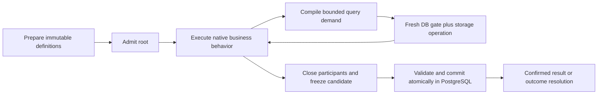

# Behavior and execution design

Status: first candidate to implement and test; runtime, schema and performance
are unproved. Module boundaries are in [MODULES.md](./MODULES.md).

## Problem and hypothesis

The active core pays repeated client interpretation, checked command and evidence
handoff costs around legitimate storage demands. Prior captures were not all
duplicates, and a complete document-pipeline rewrite failed its performance gate.
See [the evidence map](./REFERENCES.md). Another cache or helper rewrite is not
the selected experiment.

Hypothesis: reduce complete-request cost by executing a bounded logical storage
operation at one trusted database boundary, returning its useful result and exact
dependencies, while keeping one root's pending state and settlement ownership.
This changes the amount of coordination per operation. It does not promise one
SQL statement per framework method or a particular saving before measurement.

## Required behavior

| Obligation | Meaning for the experiment |
| --- | --- |
| Durable authority | PostgreSQL alone decides committed data, history, facts and outcomes. Worker memory and coordination caches are disposable. |
| Confinement | Principal, tenant, placement, source ownership and permitted operations are checked at their relevant boundaries; no unauthorized row body is disclosed. |
| Application execution | A mixed Application mutation reads its exact snapshot plus pending writes and records point, missing-row and index-membership dependencies for serializable acceptance. |
| Framework semantics | Real Payload access/default/validation/hooks and Medusa normalization/repositories/workflows remain authoritative. Native errors, visibility, nesting and event behavior are preserved for the admitted profile. |
| Settlement | One outer owner atomically accepts effects, maintains required indexes/uniques/relations/history, records result/outcome/event intent and commits. Participants cannot settle. |
| Failure and recovery | Sticky rollback-only failures, fences, deadlines, cancellation, conflict classification and uncertain-COMMIT reconciliation remain explicit. |
| Hosting | Trusted core logic is host-neutral. The target stays a private Worker with service bindings and cache-disabled Hyperdrive; local proof does not prove hosted behavior. |

No physical SQL transaction may span untrusted execution, arbitrary hooks,
workflow suspension or remote effects. Shared storage does not make independent
framework calls atomic. External delivery follows confirmed commit through its
durable intent owner.

## Execution profiles

Use explicit profiles with separate entry contracts, not `execute(mode, options)`.

- **Direct read:** bounded authorized native read with its documented snapshot
  lifetime. It needs no mutation journal or commit capability.
- **Direct framework command:** one admitted native command owns its changes and
  outcome. Do not attach Application attempt/OCC machinery unless its actual
  execution semantics require it. A trusted DB-only segment can use a short SQL
  transaction; arbitrary native lifecycle code cannot run inside that segment.
- **Mixed Application mutation:** one logical attempt owns the original snapshot,
  dependencies and pending changes across all admitted participants. Database
  transactions are short read/settlement segments around that logical attempt.

Framework hooks that need multiple database visits require an explicitly owned
logical command lifetime. Splitting the command into independent commits is not
an optimization. Declare direct-command isolation and retry semantics before
implementing its bridge; native transaction semantics must not be silently weakened.

## Working set and atomic execution boundary

Both are part of the redesign. The working-set owner chooses how original reads,
missing/range dependencies, pending values and participant contributions are
represented and consumed. Its current APIs and intermediate evidence objects are
replaceable; exact observations, read-your-writes and resource limits are not.

The atomic execution boundary defines which calls share state, who can settle,
when failure makes the root rollback-only and when results become durable. Its
construction, participant binding and physical transaction segmentation may
change. Preserve the admitted root's atomicity, native-visible behavior and
recovery obligations; no child commit or transaction over untrusted execution.

Evaluate these decisions with the repository/workflow bridges and SQL lifecycle
as one connected path. Changing database layout beneath unchanged expensive
coordination does not by itself test this redesign hypothesis.

## Candidate lifecycle

1. **Preparation:** validate definitions and compile schema/query mechanics for
   one immutable generation. Installation owns structure and permitted writers.
   Cold preparation is measured separately; it never grants live execution rights.
2. **Entry:** authenticate the root and establish scope, generation, profile,
   snapshot if required, bounded lifetime and request/idempotency identity.
   Child participants receive narrow root-bound capabilities.
3. **Read:** compile the actual query's requirements. The storage owner performs
   fresh authorization and required mutable eligibility at the same accepting
   boundary as the read. Return bounded rows and precise dependency information;
   do not transport a whole catalog for callers to reconstruct readiness.
4. **Local execution:** retain original observations and pending values under
   one owner. Reuse immutable facts and canonical values where ownership permits.
   Framework-visible copies remain isolated from mutable internal state.
5. **Freeze:** stop/join owned work, refuse late writes, retain sticky failure,
   and construct one detached commit candidate. Freezing is not durable success.
6. **Settlement:** freshly check authority/fences/generation and constraints,
   validate dependencies required by the profile, and atomically materialize all
   required data and outcomes. Only confirmed commit produces durable success.
7. **Uncertainty:** resolve by durable request/attempt identity before retry.
   Known precommit rejection and unknown commit are different states.

The recommended coarse read is bounded selection plus permitted row acquisition
and dependency capture. If authorization requires a native callback between
membership and body access, keep that boundary. Never transfer protected bodies
early to improve a count. Combining independent demands also needs snapshot,
failure-order, resource and dependency equivalence; different reads cannot
simply be dropped because their results happen to be empty.

## Checks and their lifetimes

| Check | Owner/lifetime | Replacement condition |
| --- | --- | --- |
| Installed SQL, tables, permissions and protected writers | Installation generation | Full proof on managed install/maintenance; serving role cannot alter protected structure. Maintenance must drain/fence, reverify and reopen safely after crashes. |
| Schema shape, codecs, index definitions, source ownership definitions | Immutable preparation | Retain by exact authenticated generation, with bounded cache/resource lifetime. |
| Principal, request capabilities, allowed source/method | Entry and operation boundary | Root-bound capabilities; current authorization remains required before disclosure and settlement. |
| Current placement, generation, revocation, expiry | Storage/settlement accepting boundary | Small fresh database gate with a complete writer/invalidation inventory. No TTL authority cache. |
| Index readiness and snapshot retention | Actual required access path | Prove query closure and check eligibility under the read's synchronization; unrelated definitions do not add work. |
| Write conflicts, uniqueness, references and ownership | Profile-required operation checks plus final serialized acceptance | Preserve observable native failures and final concurrent enforcement. |

For the first prototype, a generation mismatch aborts the affected operation or
attempt before disclosure/settlement; it does not silently refresh half a root.
Keeping old generations usable requires a later explicit retention/draining
contract. Snapshot retention needs an enforced lifetime or refusal, not a trusted
timestamp alone. Revocation cannot be delayed to commit after data was exposed.

Readiness is a policy over typed observations, but collection and enforcement
must share the correct database snapshot/lock lifetime. Separating modules must
not introduce a time-of-check/time-of-use race. Define post-lock database time,
lock order and every protected writer before implementing each gate.

## Storage freedom

Physical tables, indexes, SQL functions, permissions and coordination structures
may change inside disposable experimental resources. Shared logical storage and
cross-consumer relationships remain the destination; per-shop physical table
explosion is not the default. Choose structures from the execution requirements.

Before DDL, name the owners of schema generations, authority/fences, current and
historical rows, index membership, uniqueness, relationships, commit order,
retention, idempotency/outcomes and event intents. These are required concepts,
not a prescribed list of tables. Justify each persisted record and each read/write.
Identify full scans, hot locks, scope-wide contention and write amplification.

Stored data is not automatically trustworthy because it came from PostgreSQL.
State what managed writer permissions enforce and which corruption checks remain.
Changes to internal formats need experimental fixtures and codecs; existing
durable formats cannot be discarded by declaring the experiment isolated.

## Decisions that remain open

- Exact SQL/table layout and which existing primitives can be reused without
  importing the old orchestration.
- The smallest complete query/row acquisition contract for each native workload.
- Direct framework command isolation, replay eligibility and hook boundaries.
- Which internal failure ordering can change without changing supported behavior.
- Whether larger database operations materially reduce CPU and latency after
  including required authorization, dependencies and publication.

Resolve these in the relevant implementation stage and update this document with
the resulting contract. No new generic transaction engine, hosting topology or
production migration is selected by these open questions.
