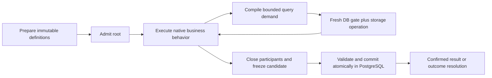

# Initial candidate behavior and execution design

Status: baseline contract for the implemented, bounded experimental candidate;
broader support and performance acceptance remain open. Module boundaries are in
[MODULES.md](./MODULES.md), with current evidence in [RESULTS.md](./RESULTS.md).

The next architecture discussion starts at [engine/README.md](./engine/README.md).
The physical transaction segmentation and Postgres coordination described here
belong to the initial candidate, not a preselected shared-engine design. Required
behavior remains binding until explicitly revised; proposals do not change runtime.

## Problem and hypothesis

The active core pays repeated client interpretation, checked command and evidence
handoff costs around legitimate storage demands. Prior captures were not all
duplicates, and a complete document-pipeline rewrite failed its performance gate.
See [the evidence map](./REFERENCES.md). Another cache or helper rewrite is not
the selected experiment.

Hypothesis: reduce complete-request cost by executing a bounded logical storage
operation at one trusted database boundary, returning its useful result and exact
dependencies, while keeping one root's pending state and settlement ownership.
This changes the amount of coordination per operation. It does not promise one
SQL statement per framework method or a particular saving before measurement.

## Required behavior

| Obligation | Meaning for the experiment |
| --- | --- |
| Durable authority | PostgreSQL alone decides committed data, history, facts and outcomes. Worker memory and coordination caches are disposable. |
| Confinement | Principal, tenant, placement, source ownership and permitted operations are checked at their relevant boundaries; no unauthorized row body is disclosed. |
| Application execution | Standalone queries use an exact authorized snapshot and record precise dependencies. Standalone and mixed mutations read their exact snapshot plus pending writes, record point/missing/index dependencies and validate them for serializable acceptance. Writes retain required revision/tombstone history. |
| Framework semantics | Real Payload access/default/validation/hooks and Medusa normalization/repositories/workflows remain authoritative. Native errors, visibility, nesting and event behavior are preserved for the admitted profile. |
| Settlement | One outer owner atomically accepts effects, maintains required indexes/uniques/relations/history, records result/outcome/event intent and commits. Participants cannot settle. |
| Failure and recovery | Sticky rollback-only failures, fences, deadlines, cancellation, conflict classification and uncertain-COMMIT reconciliation remain explicit. |
| Hosting | Trusted core logic is host-neutral. The target stays a private Worker with service bindings and cache-disabled Hyperdrive; local proof does not prove hosted behavior. |

No physical SQL transaction may span untrusted execution, arbitrary hooks,
workflow suspension or remote effects. Shared storage does not make independent
framework calls atomic. External delivery follows confirmed commit through its
durable intent owner.

## Execution profiles

Use explicit profiles with separate entry contracts, not `execute(mode, options)`.

- **Application query:** one authorized exact-snapshot read lifetime with precise
  dependency output for the existing reactivity/invalidation owner. It has no
  mutation journal or settlement capability and needs no framework runtime.
- **Direct read:** bounded authorized native read with its documented snapshot
  lifetime. It needs no mutation journal or commit capability.
- **Direct framework command:** one admitted native command owns its changes and
  outcome. Do not attach Application attempt/OCC machinery unless its actual
  execution semantics require it. A trusted DB-only segment can use a short SQL
  transaction; arbitrary native lifecycle code cannot run inside that segment.
- **Application mutation, standalone or mixed:** one logical attempt owns the
  original snapshot, exact dependencies and pending changes. A standalone
  mutation needs no Payload/Medusa participants. A mixed mutation grants admitted
  participants narrow capabilities into that same attempt; only the outer owner
  settles. Database transactions are short read/settlement segments around it.

### Application as an independent consumer

Application must not become an orchestrator that can use the new core only through
framework adapters. Preserve its portable query/mutation developer contract,
framework-neutral definitions and root/storage/settlement ownership. New internals
must support its observations and conflict protocol directly; framework row-change
facts or a successful unique check do not establish Application OCC.

Implement a small standalone Application query/mutation witness alongside the
Payload foundation, before broadening framework coverage. It exercises an exact
snapshot, point and missing reads, indexed membership, pending visibility, a
single outer settlement, and concurrent row/phantom conflicts. Reuse actual
Application function/entry behavior where available; do not substitute direct SQL
for that consumer. See the [construction contract](./IMPLEMENTATION.md#early-standalone-application-witness).

Retain distinct retry eligibility: Application may rerun an eligible complete
attempt under its outer owner; direct framework commands initially do not replay
automatically. Actions, remote effects, durable task execution and subscription
hosting keep their existing owners and separate proof obligations. This witness
does not claim their redesign or production support.

Framework hooks that need multiple database visits require an explicitly owned
logical command lifetime. Splitting the command into independent commits is not
an optimization. Declare direct-command isolation and retry semantics before
implementing its bridge; native transaction semantics must not be silently weakened.

### Direct-command contract for the first candidate

The proposed multi-visit direct command uses one logical snapshot, its own pending
state and dependencies, and one final accepting transaction. It shares mechanisms
with a mixed attempt where appropriate, without acquiring an Application API or
borrowing another root implicitly. A trusted DB-only command can instead use one
short physical transaction with an explicitly selected isolation level.

| Concern | Candidate rule |
| --- | --- |
| Read visibility | Multi-visit commands see their original snapshot plus their own writes. The bridge must prove this preserves the admitted native branch; branches requiring different visibility remain unsupported until a separate explicit contract is selected. |
| Hooks and nesting | Native lifecycle code runs outside physical transactions. Admitted same-command nested calls share pending state and sticky failure; they cannot settle independently. Independent outer calls remain independent. |
| Conflict | Validate earlier observations at settlement. A final SQL transaction at `SERIALIZABLE` alone does not validate reads made in earlier transactions. A known conflict produces the profile's declared failure, with no partial durable result. |
| Replay | Automatic replay of direct framework commands is disabled initially. Enabling it requires whole-command eligibility, hook/compensation behavior and an explicit error-to-retry contract. A repository method cannot retry independently. |
| Remote effects | Refuse effects/suspension outside the admitted profile before invocation. Durable intent delivery happens after confirmed commit. Business compensation remains native-owned where admitted; rollback is not a replacement for it. |
| Unknown COMMIT | Resolve the durable command/attempt identity before any re-execution. An unknown outcome is not a retryable conflict or confirmed rollback. |

These are experimental admission rules, not a claim of arbitrary native framework
compatibility. Record each starting workload's native visibility and failure
mapping before implementing its bridge. Application retries remain owned
by the outer attempt under their separate replay contract.

## Complete query operations

The core contract describes the result the caller needs. Do not implement count
or existence by constructing a find result and discarding its documents. The
query owner defines semantics; storage may combine the required work into a
bounded database operation. Internal SQL steps are not additional domain APIs.

Every operation identifies its root/profile, logical source, authenticated
definition selection, normalized predicate/access path, requested result shape,
snapshot contract and remaining row/byte/time limits. It returns an accepted
result, exact profile-required dependencies, and resource consumption. No cached
result grants permission to disclose data again under a different authority.

| Operation | Input and useful result | Dependency and bound requirements |
| --- | --- | --- |
| Point | Scoped identity and admitted fields; row/projection or exact absence | Record the observed row version or absence. Apply row and byte bounds before disclosure. |
| Indexed page | Predicate, stable order/tie-breaker, cursor and fields; page plus continuation/lookahead | Prove the selected prefix and successor or exhaustion, including changed membership. Bound examined entries, not just returned rows. A page does not imply a total count. |
| Exists | Supported predicate; Boolean | A positive witness must remain sufficient under concurrent changes; a negative result needs evidence of no match over its search domain. Never interpret budget exhaustion as false. |
| Exact count | Supported predicate; scalar total | Capture evidence covering all changes that could alter the counted set, including phantoms. Charge examined entries/rows; an exact count is not generally constant time. |
| Find-and-count | Page demand plus total; both results from the declared visibility | Combine only when native callback/population ordering permits it. Count evidence covers the entire counted set, not just the returned page. |
| Relation frontier | Scoped source identities, relation definition and visibility; bounded target identities/projections | Include relation membership and required endpoint dependencies. Authorization of a source is not authorization of every target. |
| Admitted aggregate | Declared grouping/aggregate and predicate; exact typed result | Specify value/null/overflow semantics, full contributing-set dependencies and work bounds. Add only aggregates required by an admitted workload. |

Authorization applies to scalar answers and membership as well as bodies. The
eligible page path is fresh gate -> selection -> authorized acquisition -> bounded
result and dependencies. If a native access callback must run after membership
selection and before body access, retain two segments and revalidate authority
at the later acquisition. Do not hold a SQL transaction across that callback.

Mutation-profile operations merge pending state with the root's original snapshot;
direct reads honor their declared snapshot without constructing mutation state.
Query projections do not waive native requirements to validate complete results
before framework-level projection. Unsupported predicates/shapes fail explicitly;
validate required query semantics before data-dependent shortcuts. If establishing
the promised result exceeds its budget, refuse; intentional pagination carries
its declared continuation and never implies an unproved count or exhaustion.

For PostgreSQL-dependent predicates, evaluate eligible committed data beside its
storage and combine only the relevant pending changes. Do not reread current rows
as a substitute for the root's original observations. Canonical bytes alone do
not make every predicate SQL-queryable: first evaluate ordered indexes/covering
fields, then a declared derived query projection if necessary. Define exact
semantics, atomic maintenance, historical visibility and measured write/storage
cost for any projection; it is not a second committed-data authority.

## Working set and atomic execution boundary

Both are part of the redesign. The working-set owner chooses how original reads,
missing/range dependencies, pending values and participant contributions are
represented and consumed. Its current APIs and intermediate evidence objects are
replaceable; exact observations, read-your-writes and resource limits are not.

The atomic execution boundary defines which calls share state, who can settle,
when failure makes the root rollback-only and when results become durable. Its
construction, participant binding and physical transaction segmentation may
change. Preserve the admitted root's atomicity, native-visible behavior and
recovery obligations; no child commit or transaction over untrusted execution.

Evaluate these decisions with the repository/workflow bridges and SQL lifecycle
as one connected path. Changing database layout beneath unchanged expensive
coordination does not by itself test this redesign hypothesis.

## Candidate lifecycle

1. **Preparation:** validate definitions and compile schema/query mechanics for
   exact immutable definition versions. Installation owns structure and permitted
   writers.
   Cold preparation is measured separately; it never grants live execution rights.
2. **Entry:** authenticate the root and establish scope, installation identity,
   selected definition versions, profile, snapshot if required, bounded lifetime
   and request/idempotency identity.
   Child participants receive narrow root-bound capabilities.
3. **Read:** compile the actual query's requirements. The storage owner performs
   fresh authorization and required mutable eligibility at the same accepting
   boundary as the read. Return bounded rows and precise dependency information;
   do not transport a whole catalog for callers to reconstruct readiness.
4. **Local execution:** retain original observations and pending values under
   one owner. Reuse immutable facts and canonical values where ownership permits.
   Framework-visible copies remain isolated from mutable internal state.
5. **Freeze:** stop/join owned work, refuse late writes, retain sticky failure,
   and construct one detached commit candidate. Freezing is not durable success.
6. **Settlement:** freshly check authority/fences/required versions and constraints,
   validate dependencies required by the profile, and atomically materialize all
   required data and outcomes. Only confirmed commit produces durable success.
7. **Uncertainty:** resolve by durable request/attempt identity before retry.
   Known precommit rejection and unknown commit are different states.

The recommended coarse read is bounded selection plus permitted row acquisition
and dependency capture. If authorization requires a native callback between
membership and body access, keep that boundary. Never transfer protected bodies
early to improve a count. Combining independent demands also needs snapshot,
failure-order, resource and dependency equivalence; different reads cannot
simply be dropped because their results happen to be empty.

## Checks and their lifetimes

| Check | Owner/lifetime | Replacement condition |
| --- | --- | --- |
| Installed SQL, tables, permissions and protected writers | Installation generation | Full proof on managed install/maintenance; serving role cannot alter protected structure. Maintenance must drain/fence, reverify and reopen safely after crashes. |
| Schema shape, codecs, index definitions, source ownership definitions | Immutable preparation | Retain by exact authenticated selected versions, with bounded cache/resource lifetime. |
| Principal, request capabilities, allowed source/method | Entry and operation boundary | Root-bound capabilities; current authorization remains required before disclosure and settlement. |
| Current placement, installation incarnation, revocation, expiry | Storage/settlement accepting boundary | Small fresh database gate with a complete writer/invalidation inventory. No TTL authority cache. |
| Index readiness and snapshot retention | Actual required access path | Prove query closure and check eligibility under the read's synchronization; unrelated definitions do not add work. |
| Write conflicts, uniqueness, references and ownership | Profile-required operation checks plus final serialized acceptance | Preserve observable native failures and final concurrent enforcement. |

Keep installation identity, selected schema/definition versions and authorization
revocation distinct. An incompatible installation change or loss of required
eligibility aborts before disclosure/settlement; do not refresh half a root.
Unrelated schema-head movement must not abort a root whose selected definitions
remain valid. Retaining selected versions requires an enforced retention/draining
contract. Revocation cannot be delayed to commit after data was exposed.

Readiness is a policy over typed observations, but collection and enforcement
must share the correct database snapshot/lock lifetime. Separating modules must
not introduce a time-of-check/time-of-use race. Define post-lock database time,
lock order and every protected writer before implementing each gate.

### Identity and invalidating writers

Separate immutable admitted identity (scope, correlation and original provenance),
mutable execution authority (status, fence, revocation, placement, deadline and
retention eligibility), and operation demand (method, source, access paths and
remaining bounds). Transport compact identity and demand; PostgreSQL freshly
checks mutable facts. Immutable records need enforced database writer rules;
a branded type, digest or signature does not enforce immutability in storage.

This matrix defines synchronization obligations, not installed lock SQL. Before
DDL, bind every row to actual tables/functions, permitted roles, lock modes and
one global acquisition order. Include every maintenance/recovery path, not only
normal requests. An unaccounted invalidating writer blocks removing its check.

| Protected fact | Invalidating writers to enumerate | Read/settlement synchronization and required race witness |
| --- | --- | --- |
| Installation identity and structural integrity | Installer, migration, repair, maintenance reopen | Readers/settlers and structural writers share an enforced fence/drain protocol. A crash or replacement cannot reopen unchecked structure. |
| Root status, fence and current access | Cancellation/terminalization, revocation, placement transfer, attempt replacement | Protect fresh acceptance through the database operation; recheck at later segments. Revocation/fence change must prevent later protected disclosure or settlement. |
| Selected definitions and source ownership | Activation, retirement, binding replacement, ownership changes | Retain exact selected versions and validate relevant changes. Unrelated head movement proceeds; consumed definition changes conflict/refuse as required. |
| Required access-path eligibility | Build completion/failure, index/unique/reference retirement or repair | Read and build writers coordinate on the required path. A concurrent retirement cannot serve an invalid path; unrelated unavailable paths do not block it. |
| Snapshot and history retention | Retention advancement, GC, root expiry and release | Retention writers respect admitted live observations/leases or cause a defined refusal. No read may combine data from an expired snapshot with newer metadata. |
| Data dependencies and constraints | Every business writer, repair and build publication affecting the selected data | Final acceptance detects row/missing/range conflicts and concurrent unique/reference violations. All writers participate; a serving-role bypass must fail. |
| Commit order and durable outcome | Settlement, outcome resolution and outcome/history retention | Serialize accepted publication per scope and preserve identity until resolution is safe. Test concurrent roots and lost COMMIT responses. |

Read-side row locks, transaction-scoped advisory locks or a different protocol
are implementation candidates. None may be swapped locally without updating all
relevant writers and proving equivalent synchronization. Measure their server
work, WAL and lock occupancy as well as client round trips. Fresh database time
must be evaluated at the contract's accepting point, including after lock waits.

## Settlement and commit order

The first candidate preserves scalar per-scope committed order. It may replace
the clock's physical representation, but sequence allocation alone (for example
`nextval()`) does not establish commit visibility order.

Finish/join business work and freeze the root before settlement. Prepare immutable
effects, canonical encodings and relevant changed-index plans outside the commit
lock. In one short accepting transaction, recheck live authority and dependencies,
enforce concurrent constraints, materialize effects and atomically record history,
result, event intent and commit order. Planning outside the lock never substitutes
for checking mutable facts inside acceptance.

Keep this one coherent protocol with replaceable planning, enforcement and SQL
implementations; one database call must not hide an unmeasured SQL monolith.
Measure lock hold/wait time and independent concurrent writes in one scope from
the first candidate. Revisit ordering/partitioning only if the shortened section
still fails the required throughput/tail-latency workload; that needs a separate
visibility contract and migration decision, not a local lock removal.

## Storage freedom

Physical tables, indexes, SQL functions, permissions and coordination structures
may change inside disposable experimental resources. Shared logical storage and
cross-consumer relationships remain the destination; per-shop physical table
explosion is not the default. Choose structures from the execution requirements.

Existing generic storage families are a useful comparison candidate, not a fixed
layout or required first implementation. Replace representations that force
unnecessary transfer, decoding, scans or proof work. Record why each retained or
changed family supports the operation contracts, including history, maintenance
and write amplification. Preserve shared logical relationships across consumers.

Before DDL, name the owners of schema generations, authority/fences, current and
historical rows, index membership, uniqueness, relationships, commit order,
retention, idempotency/outcomes and event intents. These are required concepts,
not a prescribed list of tables. Justify each persisted record and each read/write.
Identify full scans, hot locks, scope-wide contention and write amplification.

Stored data is not automatically trustworthy because it came from PostgreSQL.
State what managed writer permissions enforce and which corruption checks remain.
Changes to internal formats need experimental fixtures and codecs; existing
durable formats cannot be discarded by declaring the experiment isolated.

## Decisions that remain open

- Exact SQL/table layout and which existing primitives can be reused without
  importing the old orchestration.
- The smallest complete query/row acquisition contract for each native workload.
- Exact native compatibility evidence and failure mapping for the proposed direct
  command profile; any additional visibility/replay profile needs its own contract.
- Concrete writer/lock manifest and physical enforcement of selected-version
  retention, revocation and installation replacement.
- Which internal failure ordering can change without changing supported behavior.
- Whether larger database operations materially reduce CPU and latency after
  including required authorization, dependencies and publication.

Resolve these in the relevant implementation stage and update this document with
the resulting contract. No new generic transaction engine, hosting topology or
production migration is selected by these open questions.
