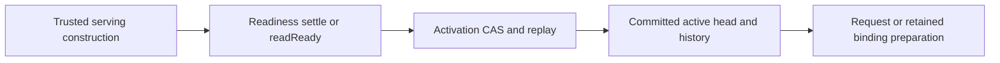

# Application Execution Owners

Start at [applicationServing.ts](applicationServing.ts). It constructs the actual
readiness, activation and serving graph from trusted database, installation,
authority and runtime inputs. Framework adapters consume issued serving bindings;
they do not reconstruct this graph for each business operation.

This folder owns deployment evidence and authentic Application selection.
[The executor](../../../executor/src/mutation/) owns Application execution;
[the journal](../execution/journal/README.md) owns attempt observations and pending
changes; [point publication](../commit/point/README.md) owns authoritative settlement.
Payload and Medusa retain their native lifecycle and business behavior.

## Follow Setup And Activation

These operations prepare a deployment for serving. They are distinct from a
business request and do not run as a mandatory pipeline on every call.

1. `constructApplicationReadinessOwners` assembles schema, candidate, unique,
   physical, relation, task and cold-runtime ports. Read serving has a separate
   protected construction path.
2. [readiness/repository.ts](readiness/repository.ts) keeps `settle` and `readReady`
   ordering visible. Preparation captures the selected target rows; bundle,
   schema, physical and cold owners authenticate the required evidence;
   persistence settles readiness in the existing target transaction. Capture
   transactions close before hashing and cold materialization.
3. [activation/repository.ts](activation/repository.ts) keeps `activate` and
   `readActive` visible. Activation captures the exact CAS token, prepares evidence,
   then acquires installation protection before scope and metadata locks. Fresh
   validation, history, maintenance, ownership, revocation, read-binding and head
   writes remain under their actual atomic settlement owner. Replay retains its
   existing identity and outcome rules.
4. A committed head can be prepared for a particular execution profile. Preparation
   issues evidence; it does not make future requests permanently authorized.

## Follow A Business Request

1. The caller chooses its admitted operation and authentic serving instance.
   [repositoryIdentity.ts](activation/repositoryIdentity.ts) dispatches binding
   preparation through the registered repository; it does not perform SQL itself.
2. [bindingPreparation.ts](activation/bindingPreparation.ts) captures the selected
   Application and its correlated readiness. Request preparation excludes the
   optional retained-host allocation across the complete nested preparation graph.
   Retained preparation charges and registers disposal with its actual lease.
3. [bindingAcceptance.ts](activation/bindingAcceptance.ts) authenticates selection,
   transaction, current clock, checked head and required readiness for this use.
   Accepted binding lending ends with the callback; metadata writers invalidate
   loans through the same lower identity owner.
4. The actual operation runs under its own execution profile: Application work
   uses the executor and journal, while direct CMS or Commerce operations use
   their restricted framework host. Only that profile's trusted outer owner can
   settle. Read-only operations close their snapshot without mutation publication.
5. Publication and recovery follow the [complete execution map](../../../../roadmaps/execution-architecture/architecture.md).
   Native hooks, finite atomic workflows and durable tasks retain their distinct
   retry, callback, transaction and post-commit lifecycles.

Stored readiness retains its authentic located target. Fresh schema, physical
requirement and unique-catalog reads reuse the actual accepting transaction when
that target authenticates the same control database. A separate control database
keeps its own bounded reader. Acceptance still checks current catalog contents
and mutable eligibility; retention does not replace those checks.

Current preparation has its own [currentBinding.ts](activation/currentBinding.ts)
owner for probes, schema fixation, semaphore exclusion and lexical refresh loans.
Protected indexed reads use [standaloneBinding.ts](activation/standaloneBinding.ts)
and its final installation/epoch guard. Finite initial preparation, confirmed
replacement and cold recovery use [finitePreparation.ts](activation/finitePreparation.ts).
Their issued identities remain separate; these are explicit execution profiles.

## Find A Responsibility

| Folder or module | Owns |
| --- | --- |
| `activation/contracts`, `constructionContracts`, `errors`, `limits` | Exact capabilities, outcomes, construction inputs and the existing error family |
| `activation/selectionIdentity`, `repositoryIdentity`, `finiteIdentity`, `currentEntryIdentity` | Singular private issuer registries and specific claims, dispatch and finite/current identity operations |
| `activation/acceptedBinding` | Accepted-token identity, transaction lending, invalidation and callback cleanup |
| `activation/bindingPreparation`, `bindingAcceptance`, `currentBinding`, `standaloneBinding`, `finitePreparation` | The actual preparation and fresh acceptance operations for each admitted profile |
| `activation/capture`, `headCapture`, `metadataProjection`, `activeRead` | Exact foreign capture, head decoding, detached metadata projections and active-head reads |
| `activation/activationPersistence`, `readBindingPublication`, `databaseBoundary`, `repository` | Activation writes/replay, canonical parent-derived read bindings, native SQL/transaction boundaries and ordered assembly |
| `readiness/contracts`, `constructionContracts`, `errors`, `limits`, `identity` | Exact readiness contracts, one issuer family and its specific preparation/capture operations |
| `readiness/activationTarget`, `bundle`, `coldEvidence`, `physicalCoverage`, `controlSchema`, `storedAuthority` | Existing target, bundle, runtime, physical, schema and authority correlation |
| `readiness/preparation`, `acceptance`, `persistence`, `frames`, `outcomes`, `databaseBoundary`, `repository` | Capture, fresh validation, atomic readiness settlement, canonical data, failure projection and ordered assembly |
| `activeHead/contracts`, `errors`, `identity` | Checked-head contracts and the original private issuer registries below the SQL reader |
| `applicationActiveHeadRead.ts` | Actual protected SQL reads, decoding and checked-head cache behavior |
| `relations/`, `ownership/`, `tasks/` | Their distinct relation, write-ownership and durable task contracts |

Contracts and identity claims do not depend on SQL construction. The internal
`application-activation` package route exposes explicit consumer contracts,
errors and authentic read-only claims; `application-activation-construction`
is for trusted assembly. Other owners import concrete local modules. There are
no compatibility forwarding files or mutable registry exports.

## Tests And Failure Evidence

Use [the Application test map](../../test/README.md#application-lifecycle-tests)
to find settlement, physical coverage, activation, binding, finite, task, action,
mutation and query cases. Existing current, standalone, metadata, catalog,
relation and ownership witnesses remain with their concrete owners.

Malformed CAS inputs run through the real activation API without getters or
authority work. Native Drizzle SQLSTATE witnesses verify the actual outer failure
and retry decision. Paired composite lifetime scenarios use authentic relation
and policy heads inside a genuine retained construction: request evidence remains
valid after that unrelated host closes, while retained evidence is disposed and
refuses use. These tests preserve fresh acceptance and do not grant executable
authority merely by recognizing a preparation token.
