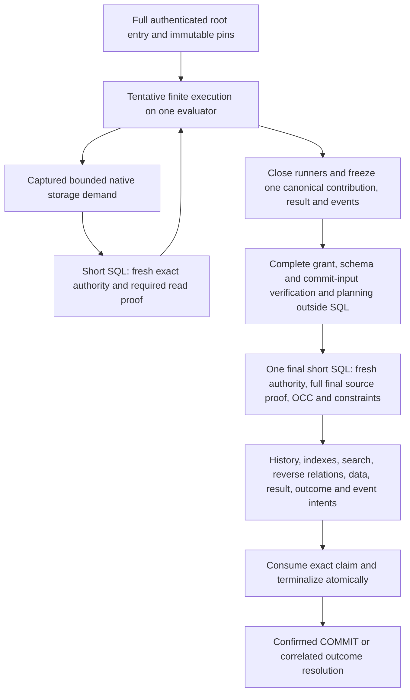

# Orchestration Refactor Targets

Status: **the accepted standalone-read replacement is implemented for its local
profiles.** Consumer and installation cutover is complete. The owner accepts the
recorded latency for now; full performance targets remain unproven and tuning is
paused. The finite execution proposal below retains its separate owning gates.

## Standalone Read Refactor

The [first implementation preflight](./standalone-read-redesign-preflight.md)
owns the complete outcome: managed installation integrity, reusable authenticated
immutable preparation, query-required serving readiness and compact fresh
authority through the genuine standalone native read. These are selected
mechanism replacements, not indefinite proposals awaiting another general
direction decision.

The [accepted design amendment](../../design-notes/flarex-db-accepted-design.md#selected-standalone-read-replacement)
permits replacing repeated role/catalog/trigger attestation once the managed
writer/maintenance contract is implemented and proven. It retains fresh access,
scope/placement/version identity, revocation, required mutable eligibility and
snapshot behavior. No cached live verdict or pooled-session assumption is valid.
Do not freeze today's attestation frequency while calling its SQL compact.

The first consumers are real standalone Product scalar and selected collection
retrievals, plus actual shared standalone consumers affected by the replacement.
Their matched warm gates are paired added overhead <=2/5 ms median/P95 and total
request <=5/10 ms. Cold/preparation misses, reconnect, schema growth and concurrent
writer behavior are also required gates; exact measurement rules live only in
the preflight. These targets are unmeasured engineering goals.

Use existing metadata, query and host owners. Move full structural verification
to managed installation changes, not every cold Worker. Extend bounded immutable
leases without selecting Worker pooling. Preserve native callbacks and actual
standalone snapshot lifetimes. Replace displaced selected-reader assembly in the
same slice, retaining full-proof paths only for named other consumers.

The failed publication candidate remains preserved separately and is not the
implementation baseline. No new publication experiment precedes this slice.
The [main roadmap](./README.md) owns order and status;
[reassessment](./orchestration-simplification-preflight.md) owns the architectural
challenge record. Their old planning-only labels are superseded for this scope.

## Deferred Finite Proposal

The successor [whole mutation preflight](../mixed-mutation-core/24-whole-mutation-redesign-preflight.md)
now owns the owner's requested total replacement and current recommended contract,
including entry and unified Application/native pending ownership. Its recovery
choice remains pending. The material below is supporting proposal/history; it
does not override the delivered slice 23 contract or select its successor.

Everything below describes the separate finite/mixed target and its retained
source analysis. It is **not the selected first slice**, and its unresolved
terminal durability decisions or historical numerical-ceiling deferrals do not
block the standalone decision above. Current finite entry/seal/publication and
recovery semantics remain until their own coherent replacement is selected.
Historical line numbers and counts below identify the inspected baseline and
must be rechecked before a finite implementation.

### Source findings and their limits

| Current finding | Consequence for the proposal |
| --- | --- |
| `logicalDocuments/rootEvaluator.ts` already shares rows, point/absence dependencies, scans, ordered/page/search/unique observations and pending Application seeds. Borrowed finite construction is local. | Extend this owner; do not create another global working set or claim that every native operation starts from an independent pending copy. |
| `sessionJournalStore.ts:makeAttemptReadTransaction` enters the full exact-running kernel at an actual storage frontier. Source admission then checks source authority/head and readiness. | The first proposal keeps that actual authority cut and its lock/time/failure order. Narrow required readiness work at that same cut. |
| `logicalStorageReadiness.ts:selectSources` selects complete owning-source tables, adds view owners and transitive strong-reference-connected sources, then selects their ordered, unique and search definitions. | A scalar demand can inspect unrelated definitions from its own source. Demand selection belongs here and in existing storage query owners, not in a method-name allowlist or adapter cache. |
| The retained inspected scalar Product trace selected 73 ordered-build rows. | This is retained trace evidence, not a fresh count or proof that all 73 rows are necessary for retrieval. Attribute the native control before selecting a cost budget. |
| `workingSet.ts:pendingSeeds` selects every unhydrated Application point whose table belongs to the borrowed source. `runStorageRead` hydrates them before requested work. | Defer unrelated seeds, but authenticate each relevant seed's original snapshot and observation before it affects point, predicate, order, page or relation membership. |
| `compileLogicalRelationalRead`, `workingSet.collectSelections` and `withStorageFrontier` already capture query mechanics and group bounded storage work. Medusa `ReadPlan` and `populateCommerceRelations` already express root selection and population, including grouped `IN` reads. | Reuse and connect these owners. Replacing them with another planner/interpreter or moving native callbacks under SQL would add authority and duplication. |
| Borrowed `workingSet.close` uses cursors and incremental activity/dependency slices. It is not a copy of all historical root activity. Child close still detaches contributions, partitions source evidence and feeds journal encoding plus `finite.entries`/`finite.points`. | Remove proved duplicate global projection at freeze while retaining operation authentication, results, events, accounting and failure order. Measure actual bytes/allocations before claiming quadratic copying. |
| Current healthy finite terminal work has durable seal, separate finishing and publication. Slice 17 removed repeated healthy reloads, not these three transactions. | A single final transaction must replace their connected semantics and recovery consumers; concatenating calls or bypassing the finishing check is insufficient. |

The pinned native `retrieveProduct` normalizes `variants.images` into `variants`
and `images`, performs the root internal retrieve/repository `find`, then may call
`productVariantProductImageService_.list` to assign images before serialization.
Those are two native demands on that branch. Root/relation grouping may
reduce Flarex decomposition within each demand; it does not justify promising
one transaction or one query for every retrieval. Empty branches, native result,
NOT_FOUND behavior, visibility, relation order and full serialization remain
framework-owned.

The first matched ledger uses the pinned MikroORM repository against Flarex's
existing standalone CommerceHost for the same scalar selection of six fields and
the same collection population, seeded through deterministic native public create
methods in both lanes. It introduces no private mixed-profile admission extension.
Constructor/bootstrap identities are recorded, selected retrieval bodies match,
and complete scalar/collection DTO and native missing-error parity are established.
The control cannot prove full private-profile equivalence,
variant-image support, mutation costs or whole-request performance. Private
`product-attempt.ts` currently admits retrieve ID only; widening its configuration
requires a named private admission decision and source/projection proof.

The displaced measured standalone baseline spends its first five transactions on binding
selection and ordinary Application activation/readiness construction and acceptance.
Its sixth transaction owns the fresh business snapshot, binding/Application and
protected revalidation, full logical source readiness and actual data selection.
Delivered construction and Application acceptance address repeated captured
bundle/readiness reconstruction under their named profiles. Remaining preparation
reuse and broad source proof ground the complete standalone-read next goal; the
old six-transaction distribution is not its current baseline. The finite path already retains immutable preparation via
`prepareFiniteActiveApplication` and the generalized `captureApplicationReadinessInTransaction`
under its host lifetime; it does not repeat those five standalone transactions per
retrieve. Do not equate standalone request counts with finite checked-read counts.
Native CRUD batching cannot remove this pre-method construction. Quiet, trace and
server runs are separate evidence; their durations cannot be causally subtracted.

## Deferred Recommended Finite Graph

The final SQL box is one owned transaction; the intervening materialization and
terminal nodes show responsibilities within it, not additional transactions.
All callbacks, getters, hooks, native services, workflow steps and detached
planning remain outside SQL. Reads use the original retained snapshot plus
earlier pending work. Frozen data is detached and complete but is neither a live
authority verdict nor durable recovery evidence before final COMMIT.

### Entry and tentative execution

Retain full aggregate source/root entry and confirmed entry facts from slice 19.
Bind immutable source/schema/method/principal/placement pins and opaque borrowed
capabilities to the original claim and exact attempt fence. Host preparation is
not attempt authority. Tentative method entry and pending-only work keep their
local lifetime, deadline and budget gates and cannot expose durable child success.

At each actual database access, keep the exact running session, lease, journal,
claim, fence, generation, revocation, binding/head, snapshot retention, post-lock
database time and protected tail. Body/tail refusal poisons the root even when a
framework catches the error. Persisted authority loss is discovered at the same
actual access as today; no cross-transaction cached live verdict is introduced.

Derive a read requirement from the captured query and trusted compiled metadata:
point storage/history, chosen ordered or unique access path, predicate/order/page
membership, populated/relation-filter edges, required target visibility, physical
definitions and actual coverage. Include relevant pending seeds before their
membership can matter. Requirements are exact, bounded and issuer-owned; a caller
list, matching digest, source name or method tag does not certify completeness.

Separate read readiness from full entry/final readiness and write maintenance.
A scalar read does not need an unused same-source search or ordered index solely
because it belongs to the source. Its selected access path still needs complete
fresh lifecycle/build/coverage/physical proof. Full final source acceptance and all
affected index/unique/search/reverse maintenance remain mandatory. A demand proof
cannot be passed to a full-admission consumer as a substitute.

Group captured root selection, bounded candidate hydration and compatible relation
work through the current working-set frontier. Preserve dependency and charge
order, exact predicate/negative membership, bounds, paging and output ownership.
Framework normalization and later dependent native service calls retain their
own boundaries. SQL does not call back into the service to discover more work.

### Freeze and final settlement

Keep one evaluator and one root lifetime. Borrowed operations retain authenticated
method/source identity, sequence, exact local replay, captured full native result,
events, usage and sticky first failure. Child closure closes its local capability;
it need not construct a second authoritative global pending/dependency graph.
At root freeze, first settle or interrupt all owned runners and refuse in-flight
or late writes. Project complete global dependencies and final pending state once,
with per-operation provenance sufficient to authenticate domain writes and events.

Preserve operation-local constraints at their current observable cut for the first
implementation. Moving referential or uniqueness refusal from native operation
close to root freeze changes which later callbacks execute and what callers may
catch. That is a separate semantic decision, not a copying optimization. Final
constraints independently remain serialized in authoritative SQL.

Verify canonical full inputs, signed grants, selected schemas, binding/method
authority and complete commit input through existing executor owners before
entering final SQL. Reuse existing canonical codecs and planner. Frozen graph
authenticity does not repair the separately recorded stored-body tamper limitation;
preserve its checks or approve a complete writer-protection correction.

The final persistence owner freshly authenticates exact authority and full final
source obligations, rechecks the planning head under the existing serialization,
validates complete OCC/constraints and publishes all authoritative effects in the
same transaction. It also consumes the exact claim and makes the session/journal
terminal transition. One scope clock allocation, existing lock strength/order,
history/tombstones, all materialization, result/outcome/feed/facts and event intents
remain atomic. No child or adapter acquires commit/finalizer authority.

## Deferred Finite Decisions Required Before Runtime Selection

| Decision | Options and recommendation | Contract and witness |
| --- | --- | --- |
| Intermediate readiness scope | **Recommend exact read-demand readiness at the current actual DB access**, keeping full authority, entry and final proof. Alternative: retain source-wide readiness. | This deliberately changes slice 16: an unused same-source index becoming unready after entry no longer poisons a scalar tentative read. Prove used index/search/relation failures still refuse, final full proof refuses unrelated source damage, and demand proof cannot authorize full admission. |
| Terminal durability boundary | **Recommend one final finite transaction**, conditional on the recovery contract below. Alternative: retain a durable seal checkpoint and simplify its proof/projection while preserving finish-only recovery. | Current confirmed durable seal guarantees recovery can finish without callback rerun. The recommendation moves that guarantee to final COMMIT; precommit crash can require whole finite re-execution under a new fence. This is an accepted-design/lifecycle/format decision, not an automatic performance approval. |
| Intermediate constraint timing | **Recommend retaining current operation-close refusal initially**. Alternative: defer selected constraints to root freeze with explicit native error/callback-order divergence. | Preserve caught-error rollback-only and first-failure order; separately prove any admitted timing change. This decision is independent of terminal durability. |
| Initial renewal and entry construction | **Retain complete initial renewal and authentication** pending exact owner evidence. Consider reconstructing initial live evidence within atomic entry only if every current renewal obligation is proved. | Confirmed structural entry facts alone cannot replace renewal. Retained slice 19 complete admission was 97 dispatches/four transactions; this is an old ledger, not a fresh whole trace or a cause estimate. |
| Cheaper protected metadata attestation | **Retain full present attestation**. A connection/installation-bound proof is a later alternative only after a complete writer/security/quiescence contract. | Epoch protects 23 specific immutable tables, not live heads, build progress, physical catalogs or privileged DDL. Prove reconnect/pool/login/role/database/incarnation binding and enforced privileged quiescence before removing per-guard catalog work. |
| Private retrieval configuration | Select the actual scalar/population envelope proved by the native ledger; do not widen the current ID-only finite decoder by inference. | Match native full result/error, projection/access rights, seeded relation graph and resource limits before admitting the broader private call. |

Do not combine these into an implicit blanket approval. Native attribution chooses
the justified graph and overhead budget; the owner explicitly selects semantic
changes and durable-data disposition. Existing accepted obligations control until
the selected amendment, preflight and replacement are complete.

## Recovery for the proposed final transaction

The current finishing path is real recovery machinery. OCC attempt replacement
selects running versus finishing lifecycle in `pointCommitTransaction.ts:4057`
and requires finishing claim absence at `:4340`. Uncertain publication in
`finishingOperations.ts:486–542` reconstructs the exact finishing capability and
checks the captured command before retrying publication. Removing only the seal
or finishing call would break these contracts.

The replacement must migrate `sealSuccessfulResult`, `sealFiniteRootEffect`,
confirmed seal capture, finishing liveness, healthy executor completion, conflict
retry, crash reconstruction and uncertain-outcome resolution together. It uses
the existing Postgres session/claim/outcome authority, not a host-local recovery
ledger. Request, session, attempt fence, claim owner/fence and frozen command/result
identity must correlate exactly; a new fence cannot be issued while an old commit
can still settle.

| Observation | Proposed action |
| --- | --- |
| Confirmed final COMMIT or exact correlated retained committed outcome | Return stored result and preserve event delivery identity; never rerun callbacks or capture events again. |
| Confirmed precommit abort or authoritative recovery proving the old transaction has settled without commit | Discard tentative state and allow bounded whole finite execution under a newly admitted fence/claim; rebuild framework/request state and snapshot. |
| Missing COMMIT response, failed outcome lookup, absent row without complete settlement proof, or interrupted cleanup | Keep decision unresolved and fence further execution. Neither absence nor connection failure proves rollback. |
| Cancellation races with commit | Close local capabilities, settle owned SQL/cleanup and report the actual correlated durable outcome. Cancellation does not undo commit. |
| OCC conflict | Preserve exact conflict evidence and serialized replacement, including point absence, range/page/relation/unique/reference dependencies and snapshot retention. Whole retry uses a new fence and admitted pins; it cannot silently change native behavior. |
| Duplicate request or old/same-fence execution | Retained authoritative outcome/replay or live-claim wait/refusal; no concurrent duplicate execution and no duplicate terminal effects. |

Because callbacks may rerun after a confirmed precommit crash/abort, admit only
the already bounded replay-safe finite graph with no remote effects or pauses.
Do not extend that policy to ordinary durable operations or independently
committed framework calls. Complete Cause, defects and interruption remain with
the executor/lifecycle owners; typed business/authority failures are not blindly
retried. Local mutable pending state and opaque construction handles remain
non-authoritative and end with the attempt.

## Construction and owner responsibilities

These are conceptual before/after contracts, not newly exported API names.

| Actual caller/owner today | Proposed caller/owner after connected cutover |
| --- | --- |
| `product-attempt.ts` prepares native commands/event policy; `executePrivateProductAttemptOperation` selects the command, receives a borrowed context, invokes native Product, captures activity, closes and returns detached changes/result/events/usage. | Product still owns command selection, native service construction and result/event policy. It receives the root-issued operation capability and returns full native result/events/usage; the root owns global dependency/pending projection. No entity-name dispatcher or SQL capability enters Product. |
| `commerceTransaction/borrowedLogicalAttempt.ts` constructs a bounded lifetime, attaches the evaluator, binds compiled tables and creates the working-set/context with a checked-read function. `cmsTransaction/borrowedLogicalAttempt.ts` supplies its distinct CMS request contract. | Existing borrowed owners construct thin operation views over the same issued evaluator and demand frontier. Callers provide method/source/business input, not stores, tail guards, admission templates or finalizers. Framework-specific managers, mutable Payload request/loader state, nested identity and failure mapping remain explicit. |
| Medusa `executeRead` coordinates relation filters, root window, population, projection and count timing through `ReadPlan`/catalog. | Medusa retains those decisions. Trusted captured storage mechanics group compatible demands at the existing frontier; no universal CRUD/relation engine takes over native policy. A genuine module extension remains a direct named binding. |
| Payload composition builds sanitized native configuration, bridge and scoped `BasePayload`; operations invoke actual Local API with request ownership. | Reuse this construction. Borrow the same root operation lifetime for supported Local API nesting without copying access/validation/hooks or calling `payload.db.*` as the proof. Conformance hooks remain test-owned. |
| Executor assembles confirmed seal capture, verification/planning, finishing and publication/recovery capabilities. | Executor owns freeze, outside-SQL full verification/planning, one final persistence operation and correlated resolution. The host supplies trusted configuration and owns connection/runtime release; it does not reconstruct or settle this pipeline. |

Keep persistence SQL, transactions, row/build/physical evidence and materialization
in their existing Postgres owners; keep executor retry/recovery/lifetime policy
in executor; framework behavior in adapters/native modules; host bindings and
connection allocation in hosts. New interfaces or factories must remove an actual
duplicated responsibility. Fewer imports or a smaller facade alone prove nothing.

## Replacement and durable-data inventory

| Path or contract | Disposition and completion gate |
| --- | --- |
| Full aggregate entry, immutable prepared catalogs and exact authority kernel | **Retain/extend** for confirmed full entry and fresh read/final cuts. Protect current order and real evidence; migrate demand input at the existing owner. |
| Finite source-wide intermediate readiness | **Replace** with explicit read-demand proof if selected. Delete displaced finite route, unused full-source read assembly and obsolete expectations while preserving full-admission consumers and adversarial witnesses. |
| All-source pending hydration on first read | **Replace** with relevant authenticated seed selection. Remove displaced eager hydration; prove point, negative/predicate/order/page/relation membership and later source access. |
| Root evaluator and native query/relation owners | **Extend**; preserve exact observations and native contracts. Do not retain another global pending store or duplicated query interpreter. |
| Per-operation detached global contribution and duplicate finite point/dependency projections | **Replace/delete** after one-freeze ownership is proved. Retain ordered authenticated operation/result/event/replay evidence and current constraint timing. |
| Healthy finite seal/capture/finishing choreography | **Replace/delete** only with the selected one-final semantic contract and connected executor/persistence/retry/recovery migration. Retaining seal instead selects the alternative graph explicitly. |
| Ordinary Application `prepareSeal`/`completeSeal`, durable operations, standalone Medusa/Payload | **Retain** for named distinct profiles and real durable/public obligations. Shared owner changes need their regressions; these paths are not compatibility wrappers for displaced finite execution. |
| Readers/transitions for existing finite sealed/finishing data | **Retain temporarily** only for inventoried rows until drain or verified migration finishes; then remove the displaced finite readers/formats/projections in the same cutover. |
| Committed outcomes, event intents, retained histories and conflict evidence | **Retain/migrate explicitly** with exact correlation and delivery identity. Breaking internals grants no deletion or reset authority. |

Inventory open/running finite attempts and claims/leases; running sealed journals;
finishing sealed journals; relation-conflicted rows and their persisted preceding
aggregate evidence; committed outcomes/results and event intents. Record actual
scope/placement/format and recovery reader obligations before schema/codec changes.
Recommend a quiescent cutover: stop new affected finite admission, settle active
owners, drain existing sealed/finishing work through its current authority or
migrate it under a reviewed exact protocol, preserve committed/conflict/event
evidence, validate absence of remaining old obligations, then activate the new
finite path and remove displaced readers. No silent reset, table deletion or
healthy dual engine is proposed. Any disposable-scope reset needs explicit scope
and authorization; a format version is justified only by a real coexistence or
exact decoding obligation.

## Connected delivery groups

Use a few connected groups selected from the ledger and semantic decisions.
These are proposed delivery boundaries, not helper-only goal turns. Root owns
orchestration and Git; workers own explicitly disjoint edits and both reviewers
remain read-only. Record a focused implementation preflight for each selected
group and explain materially different findings before proceeding.

| Group | Connected outcome and owners | Acceptance and cleanup |
| --- | --- | --- |
| Read admission, proof construction and native demand | Application binding selection/readiness acceptance, protected preparation and logical source demand reuse issued immutable evidence with fresh authoritative acceptance. Preserve standalone fresh snapshots and finite claims/lifetimes. Existing private ID-only retrieval is the first finite consumer; scalar/collection populated retrievals are native standalone controls. Any broader private configuration needs its named admission decision. | Matched native ledger, protection/issuer/lifetime and late-change proofs, pending/interleaving and required-read refusal witnesses; Product plus Application and actual Payload connected regressions; delete displaced repeated construction and selected finite source assembly. Keep full entry/final proof intact. |
| Root freeze, final settlement and durable recovery | Journal/evaluator/borrowed operation owners, executor verification/retry/liveness and Postgres publication/claim/terminal owners migrate together to the selected final durability graph. | PGlite and ordinary-role PostgreSQL exact OCC/constraints, standalone writer participation, crash/unknown-COMMIT/cancellation/duplicate-fence witnesses, explicit quiescent data disposition, finite workflow full integration milestone; remove displaced finite seal/finishing/projection paths. No half-cutover. |
| Entry and protected construction, only if evidence justifies it | Initial authenticated construction/renewal and prepared metadata owners may simplify residual proof only under their selected integrity contracts. | Complete actual initial proof and every fresh access/tail; ordinary-role writer/grant/DDL/connection/quiescence proofs for a protection change. Host lifecycle remains conditional and separately unapproved. Delete only the proved redundant route. |
| Integrated acceptance and final retirement | Existing Product update/Application, Product/Payload and finite workflow consumers exercise the selected complete graph with native controls and ordinary/durable/standalone regressions. | Full integration measurement, actual Local API and native workflow, scaling/concurrency/recovery gates, both final reviews and audited removal of remaining displaced consumers/data readers. This milestone closes connected acceptance, not a deferred cleanup bucket. |

Evidence may combine entry construction with another group or leave it unchanged.
Do not start it solely because it appears in this table. The terminal change
requires a full integration milestone because it changes cross-component lifecycle;
ordinary local component iterations still follow the component-first roadmap.

## Measurement, validation and discussion gates

The mandatory native ledger must account for complete setup and operation work:
native service/DAL demand, selected rows/fields/populated edges and dependent
phases; Flarex snapshot/history/pending/OCC/constraint/materialization work;
authority/readiness/claim/protection and journal overhead; every transaction,
autocommit, driver round trip, internal server-function statement and trigger;
rows/pages/bytes/allocations; quiet latency, retries/outliers and uncertainty.
Mark unavailable instrumentation unavailable. Count transport composition and
server work separately; overlapping timing spans are not additive latency causes.

Vary records, populated edges, native calls and workflow steps independently.
Necessary row/index/constraint work may grow with actual demand; repeated full
admission per row or DAL call is not accepted without a demonstrated obligation.
After the ledger, propose a small additive overhead budget per selected semantic
acceptance cut with justified required definitions and dependent phases. No
numeric ceiling, query minimum, latency saving or throughput claim is selected
here. Retain existing whole-request latency goals and their artifact owners.

Prove changed storage/transaction claims in fast PGlite and focused distinct-
connection ordinary-role real PostgreSQL lanes. PGlite cannot certify protected
runtime attestation. Preserve exact point/absence/tombstone, predicate/range/page,
relation/unique/reference dependencies, snapshot retention and serialized final
OCC against mixed and standalone writers. Exercise late readiness/head/revocation/
generation/claim/time changes, missing/foreign demand proof, relevant pending seed
authentication, exact replay, sticky Cause/rollback-only, cancellation settlement,
late runner freeze, precommit crash, lost COMMIT, failed/absent outcome lookup and
duplicate fence/result/event behavior.

Use real native Product update/retrieve/listByHandle plus Application insert/patch;
actual Payload create/update/findByID with access/validation, supported nested
afterChange update/read and caught failure; the admitted finite mixed workflow's
fanout/results/events/rollback/conflict/recovery graph. Keep ordinary Application,
durable-operation and standalone profiles distinct. Complete affected types,
builds, source/portability guards, lint and both project reviews against the exact
owned checkpoint; substantive fixes rerun both reviews. Stop owned test resources.

The bounded native retrieval ledger is available. Full setup SQL/CPU, scaling,
broader native demands and whole mixed acceptance remain gaps. Discussion may
select runtime work only after the selected graph's evidence is sufficient,
the readiness scope and terminal durability decisions are explicit, the full
caller/data/removal inventory is agreed, and the focused connected group has
measurable correctness and overhead gates. This proposal alone establishes no
implemented simplification, native parity, performance win or production proof.
