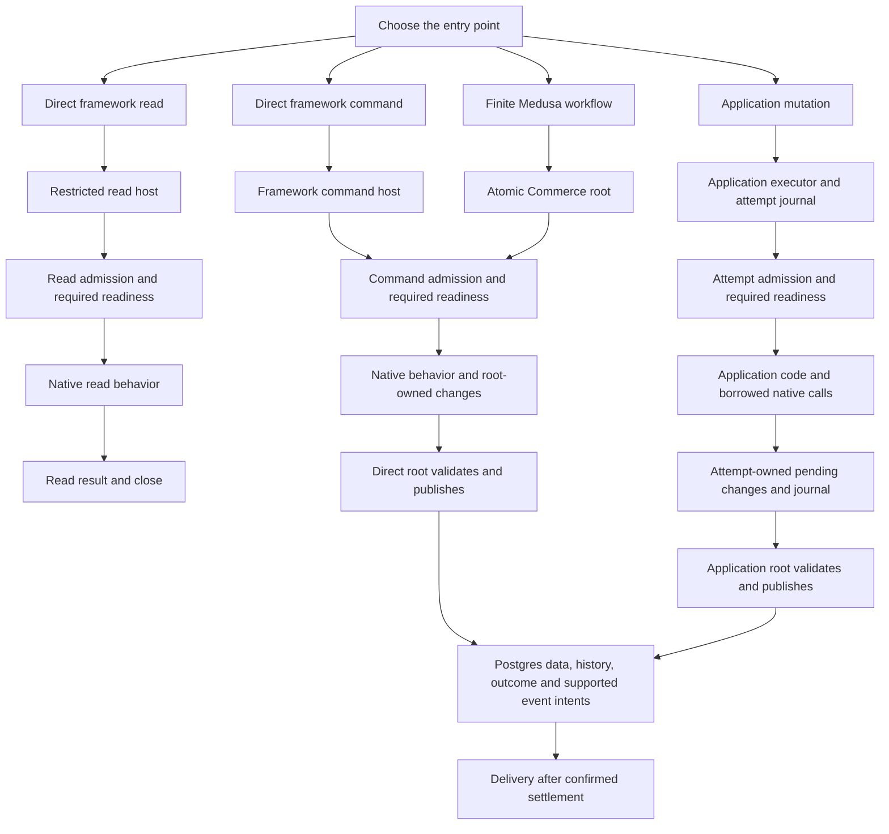

# Entry Points And Execution Ownership

## The Reader's Model

There are three entry points: Medusa, Payload and Flarex Application. They reuse
framework behavior and storage, but the outer operation determines completion.

| Entry point | Business operation | Execution ownership |
| --- | --- | --- |
| Medusa | Direct service read | Its admitted read owns completion and snapshot |
| Medusa | Direct service write | Its admitted command owns commit and recovery |
| Medusa | Supported finite workflow | One atomic root owns its admitted operations |
| Payload | Direct Local API read | Its admitted read preserves native visibility |
| Payload | Direct Local API create/update/delete | Its supported command owns commit; native validation/access/hooks remain Payload-owned |
| Application query | Application and admitted framework reads | One query owner must define consistent snapshot and dependencies; cross-framework composition is a remaining capability |
| Application mutation | Application and admitted framework operations | One logical attempt owns pending changes, conflict checks, retry and settlement |
| Durable workflow/task | Independently committed steps, waits, external work | Durable execution owns progress/recovery; each database step has its own settlement |

`Standalone` means independently executed. `Mixed` means more than one participant.
Neither is an additional fundamental operation type. A finite workflow can be
atomic; a workflow that waits or performs external work is not automatically one
database transaction. Direct framework support does not automatically admit the
same operation inside an Application query or mutation.

## Follow A Complete Request

The same responsibilities appear in several flows, but their execution owner
differs. Preparation belongs to construction; each request still checks its real
live authority and lifetime. Readiness asks whether the structures needed by this
operation are usable. Publication belongs to the outer mutation owner.



This overview shows responsibility sharing, not an executable universal pipeline.
The concrete entry determines its snapshot, retry, callback and settlement profile.

### Direct Payload Or Medusa Read

1. Trusted Payload composition creates an Application read serving instance and
   an issued CMS read binding. The adapter creates its native runtime and binds
   `find`, `findByID` and `count`; operation callers supply native arguments.
   Medusa retains its admitted Commerce reader construction.
2. [CMS read construction](../../packages/persistence-postgres/src/frameworks/cmsTransaction/read/host.ts)
   or [Commerce read construction](../../packages/persistence-postgres/src/frameworks/commerceTransaction/read/host.ts)
   captures authentic definitions, installed references and preparation lifetime.
3. [Standalone read entry](../../packages/persistence-postgres/src/storage/documents/standaloneReadTransaction.ts)
   supplies fresh authority and the bounded snapshot. Document admission and read
   readiness remain with [logical storage](../../packages/persistence-postgres/src/storage/documents/logicalDocuments/).
4. The same native operation runs with read capabilities. It returns its result
   and closes the request; there is no mutation publication.

Both the managed read-only profile and existing full-proof host reads retain
their supported semantics. Passing a write command to a reader fails closed.

### Direct Payload Or Medusa Command

1. The adapter maps native operation inputs to an admitted command; native access,
   validation, hooks/service behavior and error mapping stay in the adapter.
2. [CMS host](../../packages/persistence-postgres/src/frameworks/cmsTransaction/host.ts)
   or [Commerce request execution](../../packages/persistence-postgres/src/frameworks/commerceTransaction/request.ts)
   checks live admission, required readiness, request identity and budget.
3. Native behavior reads/writes through the admitted context. The profile's
   working set records its storage contributions and closes its bounded lifetime.
4. [CMS publication](../../packages/persistence-postgres/src/frameworks/cmsTransaction/publication.ts)
   or [Commerce publication](../../packages/persistence-postgres/src/frameworks/commerceTransaction/publication.ts)
   connects to the shared authoritative commit owners. The direct root settles.
5. [Request recovery](../../packages/persistence-postgres/src/database/relationalTransaction/requestRecovery.ts)
   and [durable outcome resolution](../../packages/persistence-postgres/src/commit/committedPointOutcome.ts)
   handle uncertain commit acknowledgement under the existing replay contract.

Payload hooks can execute within the native operation before commit. Supported
durable event intents commit with the data; event delivery follows confirmed
settlement. A hook and a durable post-commit delivery are different lifecycles.

### Finite Medusa Workflow

[Atomic Commerce construction](../../packages/persistence-postgres/src/frameworks/atomicCommerce/host.ts)
owns one admitted finite root. Its [execution owner](../../packages/persistence-postgres/src/frameworks/atomicCommerce/execution.ts)
coordinates declared participants and their root-local contributions. Native
Medusa workflow/business meaning remains in the adapter. The root checks its
lifetime/budget before normalizing foreign work and owns final publication.
Its participants cannot independently settle by nesting direct hosts.

This profile does not establish one atomic transaction around workflow pauses or
external effects. Durable workflow/task progression remains a separate owner.

### Application Mutation With Framework Participants

1. The trusted caller selects a mutation and prepares exact start evidence in
   [executor preparation](../../packages/executor/src/mutation/preparation/pointMutationStartPreparation.ts).
2. [Authentication](../../packages/executor/src/mutation/authentication/storedAttemptAuthentication.ts),
   [session activation](../../packages/executor/src/mutation/session/pointMutationSessionActivation.ts)
   and [claim supervision](../../packages/executor/src/mutation/claims/pointMutationExecutionClaimSupervision.ts)
   establish and retain the authentic outer execution owner.
3. [Finite execution](../../packages/executor/src/mutation/execution/finitePointMutationExecution.ts)
   invokes the admitted runtime through restricted
   [journal capabilities](../../packages/executor/src/mutation/journal/applicationPointMutationJournalCapability.ts).
   The [persistence journal](../../packages/persistence-postgres/src/execution/sessionJournalStore.ts)
   owns observations, pending state and participant evidence.
   Its [consumer contract](../../packages/persistence-postgres/src/execution/journal/api.ts)
   is separate from construction. The [finite registry](../../packages/persistence-postgres/src/execution/journal/finiteEntry.ts)
   owns authentic capture state; the [activation owner](../../packages/persistence-postgres/src/execution/journal/finiteEntryActivation.ts)
   performs accepting SQL, then installs a capture only after acknowledged COMMIT.
4. Payload's [participant binding](../../packages/payload-adapter/src/participant/binding.ts)
   or the admitted Commerce participant borrows the outer snapshot and pending
   changes. Native behavior runs through that borrowed context. Its completion
   contributes changes/accounting to the outer attempt; it is not a child commit.
5. The executor freezes/verifies the completed work. The
   [closed-root owner](../../packages/persistence-postgres/src/execution/journal/freezeClosedRoot.ts)
   issues the one authentic frozen capability; executor validation reads bounded
   values through the consumer API. Full frozen evidence remains with publication.
   The [point commit owner](../../packages/persistence-postgres/src/commit/pointCommitTransaction.ts)
   validates required conflict evidence and publishes one atomic outcome.
6. [Finite recovery](../../packages/executor/src/mutation/recovery/finitePointMutationRecovery.ts)
   resolves the stored outcome. An admitted conflict retry reruns a fresh complete
   attempt; commit uncertainty is not permission to replay arbitrary hooks.

No database transaction remains open across untrusted Application execution.
The borrowed operation never falls back to an independently committed direct call.
Composed Application queries still require their separate snapshot/dependency,
authorization and sandbox-connected proof.

### Installation And Tasks Are Separate Lifecycles

[Installation](../../packages/persistence-postgres/src/installation/installationLifecycle.ts)
owns protected database structure and maintenance fencing. Construction consumes
its admitted installed references; ordinary reads do not silently run migrations.
Application analysis/readiness/activation choose serving definitions. They are
not framework hook execution or commit authority.

Durable tasks own progress, retries, waits and external-effect recovery. Database
steps retain their own settlement boundaries. Sync/freshness consumes committed
facts and observations; it does not make authoritative commit decisions.

## Dependency And Folder Direction

This is the current package responsibility map. Application serving and issued
CMS/Payload construction are implemented under the active
[focused plan](03-consumer-construction-and-domain-apis.md). The remaining
[file cohesion work](05-file-cohesion-and-readable-flows.md) organizes substantial
implementation bodies without changing execution ownership.

```text
Medusa adapter                 Payload adapter
  native services                native Local API
  direct bindings                direct bindings
  participant bindings           participant bindings
  finite workflow binding        request/access/hook lifecycle
             \                   /
       explicit trusted capabilities
                      |
Application executor: query / mutation / participant orchestration
                      |
Postgres persistence: admission / reads / pending state / commit / recovery
                      |
             authoritative database

Host adapters own transport, connection and runtime wiring.
Installation owns protected database structure and maintenance.
Test support owns fixtures, fault injection and conformance instrumentation.
```

The Application executor need not sit between a direct native operation and
persistence. It coordinates Application execution and its participants. Shared
lower owners enforce database rules for both direct and composed execution.

| Existing owner | Organization direction |
| --- | --- |
| `packages/medusa-adapter` | Keep native modules, query/repository integration and workflow composition together; distinguish direct bindings from borrowed participant bindings |
| `packages/payload-adapter` | Keep native Local API and request semantics; separate direct/borrowed construction and test-only profiles |
| `packages/executor` | Keep framework-neutral Application query/mutation execution, participant invocation and retry ownership |
| `packages/persistence-postgres` | Group transaction/admission, storage and settlement responsibilities; framework facades expose restricted capabilities |
| `packages/flarex-backend` and deployable hosts | Runtime/transport composition, without duplicate database or business rules |

Read folders inside persistence are `frameworks/commerceTransaction/read/` and
`frameworks/cmsTransaction/read/`. Shared command definitions, configuration and failure
projection live outside the read and write execution bodies. The existing
full-proof direct host still owns its genuine read/write profile. Renaming or
retiring that profile depends on its callers and installation cutover, not style.

Payload now separates `runtime/native.ts`, `direct/binding.ts`,
`participant/binding.ts` and `testing/`. Direct and borrowed calls use the same
native commands. The ordinary runtime supplies its participant binding; fixed
hooks, fault scenarios, counters and raw native inspection stay in test support.
Its ordinary runtime exposes bound native methods, not command tokens or
persistence-shaped options. Application owns the serving graph; CMS issues
separate scoped read and command bindings. Borrowed invocation lookup, deadline,
closure and completion belong to CMS, while native method/error meaning remains
in Payload. See the [construction plan](03-consumer-construction-and-domain-apis.md)
for the exact capability and retirement inventory.

The [persistence source guide](../../packages/persistence-postgres/README.md)
maps database, scope, installation, application, storage, execution, commit and
framework responsibilities. The [executor guide](../../packages/executor/README.md)
maps Application orchestration in execution order. Neither adds an umbrella API
or a second transaction owner.

## Find The Corresponding Tests

| Flow or owner | Tests to start with |
| --- | --- |
| Preparation/liveness | [persistence preparation tests](../../packages/persistence-postgres/test/execution/preparation/), [mixed preparation lifetime](../../packages/executor/test/integration/mixedMutationPreparationLifetime.test.ts) |
| Direct CMS execution | [CMS host and settlement tests](../../packages/persistence-postgres/test/frameworks/cmsTransaction/), [native Payload integration](../../packages/persistence-postgres/test/integration/payload/) |
| Commerce and finite workflows | [Commerce owner tests](../../packages/persistence-postgres/test/frameworks/commerceTransaction/), [atomic Commerce tests](../../packages/persistence-postgres/test/frameworks/atomicCommerce/), Medusa adapter native conformance tests |
| Application mutation and borrowed participants | [executor mutation tests](../../packages/executor/test/mutation/), [mixed Payload attempt](../../packages/executor/test/integration/mixedMutationPayloadAttempt.test.ts) |
| Journal, capture and attempt state | [persistence execution tests](../../packages/persistence-postgres/test/execution/) |
| Commit/outcome/events | [commit tests](../../packages/persistence-postgres/test/commit/) |
| Installation and recovery | [installation tests](../../packages/persistence-postgres/test/installation/) |
| Tasks, sync and history | Their owner folders in persistence and executor tests |
| Measurement SDK and complete business graphs | [executor performance harness](../../packages/executor/test/performance/README.md), existing benchmark reports and the performance roadmap |

See the [persistence test guide](../../packages/persistence-postgres/test/README.md)
for driver lanes, shared scenarios and support ownership. Unsuffixed tests can
exercise PGlite; skipped PostgreSQL tests do not constitute real-database proof.

## Reuse Rules

One Payload create implementation should supply native behavior for both direct
and admitted mutation calls. The bindings differ because their execution owners
differ. Apply the same rule to Medusa services and selected workflow participants.
Do not unify by executing the direct host inside a borrowed mutation.

Share authenticated metadata, logical storage, conflict evidence, publication
and recovery through their actual owners. A shared helper must remove duplicated
semantics, not conceal differences behind a mode flag or registry.

Read capabilities expose reads and close. Write-capable hosts expose their real
command/recovery operations. Only the outer owner receives settlement authority;
business code never receives SQL, a raw transaction or a finalizer.

## Capability Matrix

| Capability | Current coverage | Remaining gate |
| --- | --- | --- |
| Direct Medusa read/write | Selected private native operations; managed direct reads implemented | Broader native admission and hosted activation retain their gates |
| Direct Payload read/write | Selected private Local API profiles | Each query, hook and lifecycle profile retains its supported bounds |
| Direct Medusa workflow | Selected finite atomic workflows | Arbitrary upstream workflow support is not established |
| Application mutation with Medusa/Payload | Private isolated proofs for selected operations and finite workflows | Public API/hosted activation and broader methods remain deferred |
| Application query across all three | Target direction | Snapshot, dependencies, authorization and sandbox-connected proof required |
| Durable workflow/task | Separate existing domain | No claim that every Medusa workflow is integrated with durable execution |

Use the [mixed mutation roadmap](../mixed-mutation-core/README.md),
[workflow foundations](../workflow-foundations/README.md),
[Payload adoption](../flarexdb-framework-integration/07-payload-adoption.md) and
[standalone read preflight](../core-performance/standalone-read-redesign-preflight.md)
for exact admission and completion limits.
